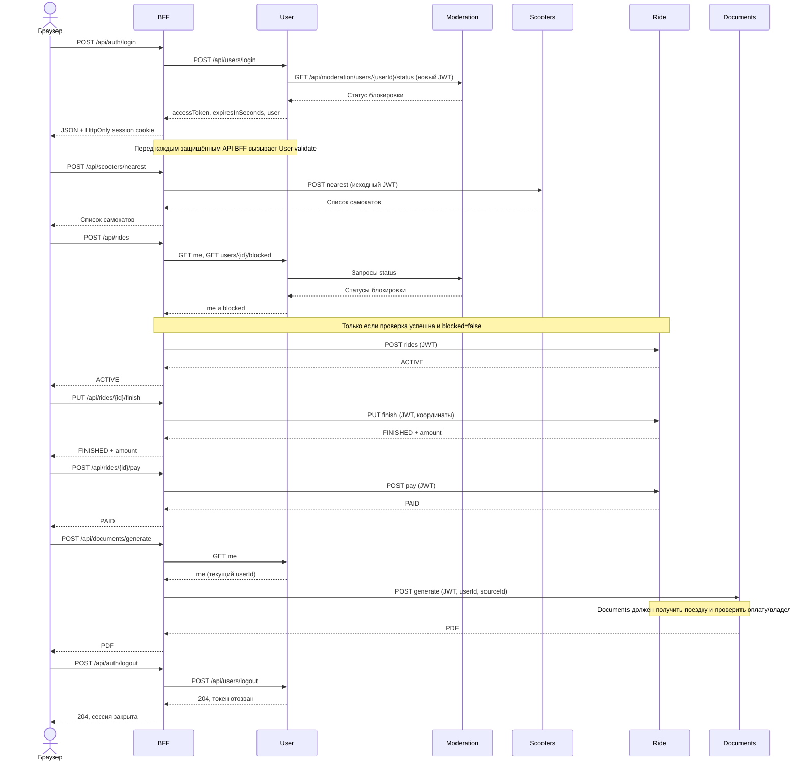

# Кикшеринг: REST-контракты микросервисов (по BFF)

Исходный документ: 16 октября 2026, @heaven. Сверка BFF/User и адресов локального стенда: 22 октября 2026.

Разделы BFF и User обновлены по реализации. Контракты остальных сервисов и пометки [предложение] сохраняются как требования/вопросы для их команд; наличие контракта не подтверждает запуск их реализаций.

## 1. Обзор и общие соглашения

Документ объединяет актуальный контракт BFF, фактический API готового User
из присланного архива и сохранённые требования к Moderation, Scooters, Ride,
Documents. «Реализовано» относится только к проверенному коду BFF/User.
Остальные API описывают ожидаемые взаимодействия; реализация соответствующих
команд не была предоставлена и не объявляется проверенной. Все 21 вопрос
исходного документа сохранены в разделе 5 с актуальными статусами.

**Статусы:** «реализовано в BFF/User» — сверено с кодом; «подтверждён адрес» —
сообщено командой, без проверки её запущенного приложения; «ожидается от сервиса» —
требование для интеграции; «предложение/открыто» — решение ещё нужно согласовать.
Ни таблица адресов, ни пример JSON сами по себе не подтверждают готовность сервиса.

| Сервис | Порт по умолчанию | Свойство в BFF | Вызывается из BFF |
| --- | --- | --- | --- |
| User Service | 8081 | `user.service.url` | да |
| Moderation Service | 8082 | нет в BFF; `MODERATION_BASE_URL` в готовом User; настройка Documents зависит от его реализации | **нет прямых REST-вызовов BFF**; User вызывает, Documents должен вызывать по своему контракту |
| Scooters Service | 8083 | `scooter.service.url` | да |
| Ride Service | 8084 | `ride.service.url` | да |
| Documents Service | 8085 | `document.service.url` | да |

### 1.1 Адреса согласованного локального стенда

| Компонент | Базовый адрес / страница |
| --- | --- |
| BFF + ScootX, порт 8080, контекст `/` | `http://localhost:8080/` |
| Вход BFF для пользователей и модераторов | `http://localhost:8080/login.jsp` |
| Прямая форма входа ScootX | `http://localhost:8080/?auth=login` |
| Регистрация | `http://localhost:8080/register.jsp` |
| User Service | `http://localhost:8081` |
| Moderation Service | `http://localhost:8082` |
| Панель Moderation (адрес подтверждён её командой) | `http://localhost:8082/admin/users.html` |
| Scooters Service | `http://localhost:8083` |
| Ride Service | `http://localhost:8084` |
| Documents Service | `http://localhost:8085` |

Пути BFF ниже указаны относительно его базового адреса. При согласованном
корневом развёртывании полный адрес входа API —
`http://localhost:8080/api/auth/login`; downstream-адрес User —
`http://localhost:8081/api/users/login`. Это разные ручки двух приложений.

Порт не задаёт context path. Здесь согласован именно контекст `/`, поэтому
префикс `/scooter-bff` в адресах этого стенда не используется. Maven по-прежнему
создаёт `scooter-bff.war`: для корневого запуска в обычном Tomcat его размещают
как `webapps/ROOT.war` либо задают application context `/` в IDE. Если положить
непереименованный `scooter-bff.war`, стандартный Tomcat даст другой контекст
`/scooter-bff`; это альтернативный способ развёртывания, а не адрес этого стенда.
BFF берёт context path динамически; прикладной код менять для `/` не требуется.

`login.jsp` и `register.jsp` совместимы со старым адресом входа, но перенаправляют
в формы единого ScootX. Формы открываются без микросервисов; для входа нужен
User с PostgreSQL/JWT-ключами и работающим Moderation. BFF не должен занимать
8081 одновременно с User.

### Общие правила

- **Формат:** JSON, UTF-8, `Content-Type: application/json`. Исключение — PDF-чек (`application/pdf`).
- **UUID:** id пользователя, поездки, тарифа и sourceId документа — строки UUID, не числа. numberPlate остаётся строкой номера.
- **Авторизация:** `Authorization: Bearer <JWT>`. BFF принимает JWT из этого заголовка либо из HTTP-сессии (кладётся туда после `/api/auth/login`) и **пробрасывает его без изменений в каждый защищённый downstream-вызов**. Каждый сервис сам валидирует токен и достаёт из него `userId`.
- **Проверка токена в BFF:** перед защищёнными `/api/*` BFF вызывает `GET {User}/api/users/validate`. Публичны только POST register/login, GET users/exists. POST auth/logout обрабатывает текущий/истёкший токен сам, без предварительного validate. Любой 2xx validate — успех; отказ — 401, недоступность/5xx — 503. Общего публичного исключения `/api/auth/*` нет.
- **Формат ошибки:** `{"error": "текст"}`. Обычные proxy-вызовы сохраняют статус и тело downstream. При разборе успешного login/me, проверке блокировки/PDF и при logout BFF может сформировать свою ошибку; поэтому «как есть» не означает все без исключения ответы.
- **Типы/размер:** JSON-тело BFF — до 64 KiB, объект со строгими типами; JSON-числа координат должны быть конечными. Готовый User принимает JSON-тело до 16 KiB (413 при превышении). Несоответствующий Content-Type API-запроса с телом — 415.
- **Заголовок и сессия:** явный Authorization имеет приоритет. Некорректный явный заголовок не заменяется привилегированным JWT сессии. Сессия BFF — HttpOnly, только cookie, без session ID в URL.
- **Origin:** ScootX работает с BFF с одного origin. BFF отклоняет межсайтовые write-запросы. Для прямых запросов панели Moderation к User его CORS_ALLOWED_ORIGINS должен включать `http://localhost:8082`; API получает Bearer, не cookie BFF.
- **Недоступность сервиса:** BFF отвечает 503. Таймауты BFF: подключение 3 с, ответ 10 с.
- **Именование полей:** camelCase. Координаты — `posX`, `posY` (в ТЗ они названы `posx`, `posy`; см. раздел «Открытые вопросы»).
- **Даты:** `birthDate` — `YYYY-MM-DD`; метки времени — ISO-8601 UTC **\[предложение\]**.

## 2. Публичный API BFF (клиент → BFF)

Основные API и маршруты BFF перечислены ниже; большинство — простое проксирование с сохранением статуса и тела ответа downstream-сервиса. Колонка «Auth» — нужен ли JWT.

| # | Метод и путь BFF | Auth | Дальше вызывает |
| --- | --- | --- | --- |
| 1 | `POST /api/auth/register` | нет | User: `POST /api/users/register` |
| 2 | `POST /api/auth/login` | нет | User: `POST /api/users/login` |
| 3 | `GET /api/users/exists?login=` | нет | User: `GET /api/users/exists` |
| 4 | `GET /api/users/me` | да | User: `GET /api/users/me` |
| 5 | `GET /api/scooters` | да | Scooters: `GET /api/scooters` |
| 6 | `POST /api/scooters/nearest` | да | Scooters: `POST /api/scooters/nearest` |
| 7 | `GET /api/scooters/{numberPlate}` | да | Scooters: `GET /api/scooters/{numberPlate}` |
| 8 | `POST /api/rides` | да | User: `me`, `blocked`; Ride: `POST /api/rides` |
| 9 | `PUT /api/rides/{id}/finish` | да | Ride: `PUT /api/rides/{id}/finish` |
| 10 | `POST /api/rides/{id}/pay` | да | Ride: `POST /api/rides/{id}/pay` |
| 11 | `GET /api/rides` | да | User: `me`; Ride: `GET /api/rides?userId=` |
| 12 | `POST /api/documents/generate` | да | Documents: `POST /api/documents/generate` |
| 13 | `POST /api/auth/logout` | текущий JWT из Bearer/сессии; повтор без JWT допустим | User: `POST /api/users/logout`, затем закрытие сессии BFF; ответ 204 |
| 14 | `POST /logout` | как выше | тот же выход для HTML-формы, затем 303 на `/login.jsp` |
| 15 | `GET /logout` | нет | страница подтверждения; ничего не отзывает |
| 16 | `GET /api/config` | да | локальная настройка `{moderationPanelUrl}` для перехода ADMIN |

BFF не вызывает REST API Moderation напрямую. Браузер ADMIN переходит на страницу панели, а User получает блокировки у Moderation. Это разные виды взаимодействия.

### 2.1 Регистрация

`POST /api/auth/register` — проверяет поля и проксирует результат User Service.
Логин: 3–64 символа латиницы, цифр, `_`, `.` и `-`, сервер приводит к нижнему регистру
и убирает крайние пробелы. Пароль: минимум 8 символов (String.length как у User),
максимум 72 байта UTF-8, без NUL. fullName обязателен: до 200 символов после trim,
без управляющих символов. birthDate обязательна: YYYY-MM-DD, от 1900-01-01 до
сегодня UTC. avatarUrl опционален. Роль клиента не пересылается; User создаёт USER.
ScootX после успешной регистрации выполняет отдельный запрос login. Если вход
не удался, аккаунт уже создан: UI предлагает войти без повторной регистрации.

```json
// Запрос
{
  "login": "ivan",
  "password": "example-password",
  "fullName": "Иван Петров",
  "birthDate": "2000-05-17",
  "avatarUrl": "https://cdn.example.com/a/ivan.png"
}
// Ответ 201: профиль нового пользователя
{
  "id": "550e8400-e29b-41d4-a716-446655440000", "login": "ivan", "role": "USER", "fullName": "Иван Петров",
  "birthDate": "2000-05-17", "avatarUrl": "https://cdn.example.com/a/ivan.png",
  "deleted": false, "blocked": false
}
```

### 2.2 Логин

`POST /api/auth/login` — в теле запроса только `login` и `password`. При успехе BFF создаёт HTTP-сессию, кладёт в неё JWT и выставляет таймаут сессии = `expiresInSeconds`. Токен мы также возвращаем в теле ответа.

```json
// Запрос
{ "login": "ivan", "password": "example-password" }
// Ответ 200
{
  "accessToken": "eyJhbGciOi...",
  "expiresInSeconds": 3600,
  "user": { "id": "550e8400-e29b-41d4-a716-446655440000", "login": "ivan", "role": "USER", "fullName": "Иван Петров",
            "birthDate": "2000-05-17", "avatarUrl": null, "deleted": false, "blocked": false }
}
```

Если User Service ответил не 2xx, статус и тело пробрасываются клиенту (ожидаем 401 для неверных данных). Отсутствующий/пустой accessToken, неверное время жизни или неправильный UUID пользователя в успешном login-ответе дают 502.

#### Переход после входа

Фронтенд читает `user` и `accessToken` из JSON-ответа login.

- `user.role === "ADMIN"`: через `location.replace` переходит на
  `http://localhost:8082/admin/users.html#accessToken=<encodeURIComponent(accessToken)>`.
- `USER`: остаётся в ScootX и открывает личный кабинет; в Moderation не переходит.
- Браузер BFF не сохраняет JWT в localStorage/sessionStorage; для BFF используется
  HttpOnly-сессия. Токен для Moderation передаётся во фрагменте, не в query string.

При отсутствии токена панель Moderation направляет на
`http://localhost:8080/login.jsp`. После получения токена панель должна прочитать
фрагмент, при необходимости сохранить JWT в своём sessionStorage, очистить
фрагмент через history.replaceState и передавать `Authorization: Bearer <JWT>`
в запросах к API. Права ADMIN проверяются сервисами, а не только фронтендом.

Адрес панели в BFF по умолчанию совпадает с адресом команды. Его можно изменить
через `MODERATION_PANEL_URL` или `-Dmoderation.panel.url=...` (приоритет JVM).
Текущий фронт — `frontend/account.js` и `frontend/api.js`; старого `js/login.js`
после объединения ScootX больше нет. `login.jsp` остаётся совместимым входным URL.

### 2.3 Проверка логина

`GET /api/users/exists?login=ivan` — без авторизации. Пустой `login` → BFF сам отвечает `400 {"error":"Укажите логин"}`. Остальное — прокси. Готовый User возвращает `200 {"exists": true}` (либо false).

### 2.4 Профиль

`GET /api/users/me` — прокси `GET {User}/api/users/me`. Внутри BFF тот же вызов используется, чтобы узнать `userId`, поэтому ответ **обязан** содержать `id` в формате UUID (иначе BFF ответит 502).

```json
// Ответ 200
{ "id": "550e8400-e29b-41d4-a716-446655440000", "login": "ivan", "role": "USER", "fullName": "Иван Петров",
  "birthDate": "2000-05-17", "avatarUrl": null, "deleted": false, "blocked": false }
```

### 2.5 Список самокатов

`GET /api/scooters` — все самокаты. Фильтр «только свободные»: `?status=READY` или `?available=true` (оба ведут к `GET {Scooters}/api/scooters?status=READY`). Другие значения `status` игнорируются.

```json
// Ответ 200 [предложение]
[ { "numberPlate": "A123BC", "status": "READY", "charge": 87, "posX": 10, "posY": 25 } ]
```

### 2.6 Ближайшие самокаты

`POST /api/scooters/nearest` — тело с `posX` и `posY`, оба обязательны, иначе `400 {"error":"Нужны posX и posY"}`. `GET` на этот путь → 405. BFF проверяет конечные JSON-числа и передаёт их без округления до int; строки, null и объекты вместо обязательных координат дают 400.

```json
// Запрос
{ "posX": 10, "posY": 24 }
// Ответ 200 [предложение], отсортирован по distance возрастающей
[ { "numberPlate": "A123BC", "status": "READY", "charge": 87, "posX": 10, "posY": 25, "distance": 1.0 },
  { "numberPlate": "B777OP", "status": "READY", "charge": 64, "posX": 12, "posY": 30, "distance": 6.3 } ]
```

Текущий ScootX читает `numberPlate`, `status`, `charge`, `posX`, `posY` и при наличии `distance`. Старый fallback `number_plate` больше не используется: актуальное имя — `numberPlate`. Единицы distance пока не согласованы, фронт не дописывает «м».

### 2.7 Самокат по номеру

`GET /api/scooters/{numberPlate}` — номер уже декодирован контейнером Servlet и кодируется ровно один раз при вызове Scooters. Ответ — один объект самоката той же формы, без `distance`; 404, если не найден.

### 2.8 Начало поездки

`POST /api/rides`. Порядок внутри BFF: (1) `GET {User}/api/users/me` → `userId`; (2) `GET {User}/api/users/{userId}/blocked`; если заблокирован — `403 {"error":"Пользователь заблокирован"}`; (3) `POST {Ride}/api/rides`. `userId` в Ride не передаётся — Ride берёт его из JWT.

```json
// Запрос
{ "numberPlate": "A123BC", "rateId": "6ba7b810-9dad-11d1-80b4-00c04fd430c8", "posX": 10, "posY": 24 }
// Ответ 201 [предложение]
{ "id": "7c9e6679-7425-40de-944b-e07fc1f90ae7", "userId": "550e8400-e29b-41d4-a716-446655440000", "numberPlate": "A123BC", "rateId": "6ba7b810-9dad-11d1-80b4-00c04fd430c8", "status": "ACTIVE",
  "startedAt": "2026-10-16T07:40:00Z", "startPosX": 10, "startPosY": 24 }
```

`rateId` — необязательный UUID (может быть null; ScootX его сейчас не шлёт). posX/posY при старте API тоже допускают null, но форма ScootX просит обе координаты. numberPlate обязателен. Тариф определяет Ride; вопрос списка/тарифа по умолчанию остаётся в разделе 5. При deleted=true BFF также запрещает старт (403). Недоступность проверки бана → 503, некорректный ответ → 502, до Ride запрос не доходит.

### 2.9 Завершение поездки

`PUT /api/rides/{id}/finish` — `{id}` должен быть UUID, иначе 404. Обе конечные числовые координаты обязательны; при ошибке — 400 до вызова Ride. Владельца и состояние поездки проверяет Ride.

```json
// Запрос
{ "posX": 15, "posY": 30 }
// Ответ 200 [предложение]
{ "id": "7c9e6679-7425-40de-944b-e07fc1f90ae7", "status": "FINISHED", "finishedAt": "2026-10-16T08:05:00Z",
  "durationSeconds": 1500, "amount": 250.00, "currency": "RUB", "paid": false }
```

### 2.10 Оплата поездки

`POST /api/rides/{id}/pay` — без тела либо с пустым объектом (BFF шлёт `{}`). id должен быть UUID, иначе 404. Владельца, состояние и идемпотентность проверяет Ride. Фронтенд не устанавливает PAID локально и не делает расчёт стоимости вместо Ride.

```json
// Ответ 200 [предложение]
{ "id": "7c9e6679-7425-40de-944b-e07fc1f90ae7", "status": "PAID", "amount": 250.00, "currency": "RUB", "paidAt": "2026-10-16T08:06:10Z" }
```

### 2.11 История поездок

`GET /api/rides` — поездки текущего пользователя; параметров нет. BFF сначала получает `userId` из User Service, потом вызывает `GET {Ride}/api/rides?userId={userId}`. Неизвестный хвост пути, например `GET /api/rides/любой-путь`, возвращает 404. Клиентский userId в query не заменяет текущего пользователя.

```json
// Ответ 200 [предложение]
[ { "id": "7c9e6679-7425-40de-944b-e07fc1f90ae7", "numberPlate": "A123BC", "status": "PAID", "startedAt": "2026-10-16T07:40:00Z",
    "finishedAt": "2026-10-16T08:05:00Z", "amount": 250.00, "currency": "RUB" } ]
```

Фронтенд использует ACTIVE → FINISHED → PAID. Сумма и статусы берутся из Ride, локальной имитации оплаты/тарифа нет.

### 2.12 Генерация PDF

`POST /api/documents/generate` — успешный ответ BFF: `200`, `Content-Type: application/pdf`, `Content-Disposition: attachment; filename="document.pdf"`, тело = байты PDF от Documents Service. Ошибки — JSON.

```json
// Чек оплаченной поездки
{ "docType": "RIDE_PAYMENT", "sourceId": "7c9e6679-7425-40de-944b-e07fc1f90ae7" }
// История поездок
{ "docType": "USER_HISTORY", "from": "2026-10-01", "to": "2026-10-31" }
// Уведомление о блокировке
{ "docType": "USER_BLOCKED" }
```

userId BFF берёт из `/api/users/me`, клиентское значение не использует.
Для RIDE_PAYMENT нужен UUID sourceId; для USER_HISTORY — корректный период.
RECEIPT принимается как старый alias RIDE_PAYMENT; status не пересылается.
Documents дополнительно проверяет владельца поездки и факт оплаты по JWT.
BFF проверяет Content-Type и сигнатуру PDF; успешный ответ не в формате PDF → 502.

### 2.13 Выход

POST `/api/auth/logout` не требует предварительного validate и вызывает User POST `/api/users/logout` с текущим JWT,
затем закрывает сессию BFF; успешный ответ — 204. POST `/logout` делает то же
для HTML-формы, затем отвечает 303 с Location `/login.jsp` при корневом контексте.
GET `/logout` показывает подтверждение и ничего не меняет.

Без JWT повторный выход допустим. 401 User при отзыве означает, что токен уже
непригоден. Если User недоступен/отзыв отклонён, сессия BFF закрывается, но BFF
возвращает ошибку, не заявляя успешный отзыв. Прочие сервисы должны учитывать
отзыв токена через User, если им нужен немедленный общий logout.

### 2.14 Настройки интерфейса и дополнительные UI-функции

GET `/api/config` защищён JWT/сессией и возвращает:

```json
{"moderationPanelUrl":"http://localhost:8082/admin/users.html"}
```

Роли не выдаются этим endpoint: доступ к админским API проверяют сами сервисы.
Вне localhost настройте доверенный HTTPS URL панели.

Профиль ScootX только для чтения, write API нет. Избранное — номера самокатов
только на устройстве, отдельно по userId; серверного endpoint избранного нет.
Координаты вводятся вручную либо по отдельной кнопке геолокации (X=longitude,
Y=latitude); система координат ещё требует согласования. Каталог требует входа.
Никакие локальные пользователи, тестовая оплата, тариф 50/8, запас хода 30 км
или имитация перемещения/разряда из старого макета не являются контрактом.
Время активной поездки может отображаться по startedAt, но сумму считает Ride.

### Коды ответов BFF

| Код | Когда |
| --- | --- |
| 400 | некорректный JSON/поля; нет `login` или `posX`/`posY` |
| 401 | нет JWT или токен отвергнут; 5xx validate не маскируется как 401 |
| 403 | явный бан/удалённый пользователь запрещает старт; также запрет Origin или отказ downstream в доступе |
| 404 | неизвестный путь внутри `/api/*` |
| 405 | неподдерживаемый метод, в том числе GET `/api/scooters/nearest` |
| 415 | тело API-запроса отправлено не как application/json |
| 502 | некорректный ответ User/статуса блокировки или неправильный PDF |
| 503 | сервис недоступен или таймаут |
| 413 | слишком большое тело на стороне User; BFF собственный лимит тела сейчас сообщает как 400 |
| любой другой | обычный proxy сохраняет ответ downstream; исключения разбора/проверок и logout описаны выше |

## 3. Контракты для команд сервисов (BFF → сервис)

Раздел 3.1 описывает предоставленный код User Service. Разделы 3.2–3.5
сохраняют ожидаемые сервисные контракты из исходного документа: наличие
этих разделов не означает, что реализации сервисов получены или проверены.
В защищённых вызовах используется Authorization: Bearer JWT; ошибки JSON.
BFF непосредственно вызывает только часть User API. Админка Moderation может
обращаться к админским User endpoints напрямую с Bearer и разрешённым CORS.

### 3.1 User Service (`:8081`)

**Реализовано в присланном User.** Пути относительны к `http://localhost:8081`;
для этих URL User разворачивается в корне (например ROOT.war), либо его context
path явно добавляют в `user.service.url` BFF.

| Эндпоинт | Доступ / тело | Фактический ответ / использование |
| --- | --- | --- |
| `POST /api/users/register` | публичный; login, password, fullName, birthDate, avatarUrl; правила §2.1. BFF не пересылает role | 201 + user; роль нового пользователя всегда USER. 409 — занятый нормализованный логин |
| `POST /api/users/login` | публичный; только login и password | 200 accessToken, expiresInSeconds, user. 401 — неправильные данные/удалённый пользователь, 503 — недоступен Moderation/БД |
| `POST /api/users/logout` | текущий Bearer | 204 — токен отозван; прямой повтор с уже отозванным JWT → 401 (BFF считает это завершённым выходом) |
| `GET /api/users/exists?login=` | публичный, корректный логин | 200 `{"exists": true}` или false; невалидный/пустой логин → 400 |
| `GET /api/users/validate` | JWT; проверяет подпись/issuer/exp, запись токена, текущего пользователя и роль | 204 — валиден, 401 — недействителен/отозван/истёк. Не вызывает Moderation; БД недоступна → 503 |
| `GET /api/users/me` | JWT | 200 user; blocked запрашивается у Moderation, его недоступность → 503 |
| `GET /api/users` | ADMIN | 200 массив активных пользователей: `[{"id":"UUID","login":"ivan","fullName":"Иван Петров"}]`; с USER → 403 |
| `GET /api/users/{id}` | сам пользователь или ADMIN; UUID | 200 user; нет активного пользователя → 404, чужой для USER → 403. Также запрашивает статус Moderation |
| `GET /api/users/{id}/blocked` | сам пользователь или ADMIN; UUID | 200 `{"blocked": true}` или false. Нет пользователя → 404; ошибки Moderation обрабатываются ниже |
| `POST /api/users/{id}/ban` | ADMIN; `{"reason":"RIDE_DANGEROUS"}` | 200 статус Moderation; проверяет существование активного пользователя и пересылает reason. Имя причины проверяется также Moderation |
| `POST /api/users/{id}/unban` | ADMIN; тело не требуется | 200 статус Moderation; проверяет пользователя, затем проксирует unban |
| `GET /api/users/blocked` | ADMIN; query limit/offset | 200 массив из Moderation; limit по умолчанию 100, диапазон 1–500; offset по умолчанию 0, неотрицательный int. Некорректные параметры → 400 |
| `GET /api/users/reasons` | ADMIN | 200 массив причин из Moderation |

Нет JWT → 401, нет требуемых прав → 403. Во внешний API BFF вынесены me/exists
из GET users и register/login/logout из auth; me защищён JWT; **проксирование админских User
маршрутов в BFF не реализовано**. Предложение об их добавлении сохранено в п.15.
Изменения профиля и публичного API назначения ADMIN в полученном User нет.
ADMIN назначается оператором через CLI PromoteAdmin; старые токены пользователя
при повышении роли отзываются. Публичная регистрация не повышает роль.

User:

```json
{
  "id": "550e8400-e29b-41d4-a716-446655440000",
  "login": "ivan", "role": "USER", "fullName": "Иван Петров",
  "birthDate": "2000-05-17", "avatarUrl": null, "deleted": false, "blocked": false
}
```

При login BFF требует непустой accessToken, целочисленный expiresInSeconds
от 1 до Integer.MAX_VALUE и user с UUID id; иначе 502. Остальные отсутствующие
поля профиля при разборе могут стать null/false, но сервисам следует выдавать
полный объект выше. Удалённый пользователь из login-ответа не принимается (403).
BFF совместим также со старым булевым ответом blocked `true`/`false`, однако
готовый User выдаёт объект. Пустой/неверный успешный blocked → 502; 5xx/сеть → 503;
только явный blocked=true становится запретом старта 403.

**JWT:** только User выдаёт RS256. Claim userId — UUID, role — USER/ADMIN;
также есть sub=userId, jti (UUID токена), iss, iat, exp. Issuer по умолчанию
`scooter-user-service`, TTL по умолчанию 3600 секунд. Приватный ключ остаётся
только у User; публичный ключ передаётся сервисам с локальной проверкой.
User дополнительно проверяет хеш/действительность токена в БД. BFF не подписывает
JWT, не хранит собственный JWT-секрет и проверяет токен через validate.
Для немедленного учёта отзыва другим сервисам одной проверки подписи недостаточно.

**User → Moderation (реализовано в User):** исходный Bearer передаётся без
изменений; status/ban/unban должны вернуть объект с тем же userId и boolean
blocked, списки/reasons — массивы. Таймаут/сеть, 429 и 5xx → 503; неверный JSON,
неверный userId/blocked, неожиданный redirect/404 → 502. 400/401/403/409
Moderation сохраняются как JSON-ошибка. blocked не хранится в User DB.
Новый пользователь при регистрации получает blocked=false без вызова Moderation
(новый UUID, JWT ещё нет). Login сначала сохраняет токен, затем вызывает status;
если Moderation не ответил корректно, новый токен отзывается, login не объявляется успешным.
me/byId/blocked вызывают Moderation; validate — нет. Нельзя делать цикл
Moderation status → полный User profile → Moderation status.

**Запуск User:** PostgreSQL, схема users/tokens из его архива, JWT-пара ключей.
Обязательные переменные: DB_URL, DB_USER, DB_PASSWORD, JWT_PRIVATE_KEY_PATH,
JWT_PUBLIC_KEY_PATH; значения секретов вводятся вне документа. Адрес Moderation —
MODERATION_BASE_URL, по умолчанию `http://localhost:8082` (без завершающего `/`).
Для прямых browser-вызовов панели User CORS_ALLOWED_ORIGINS по умолчанию включает
`http://localhost:8082`; при другом origin его нужно настроить. BFF своей БД не имеет.

### 3.2 Moderation Service (не вызывается BFF)

Прямого REST-клиента Moderation в BFF нет; отдельно настроен URL страницы панели для browser-редиректа ADMIN. Согласно текущему коду «забанен ли пользователь» выясняется через User Service (`/api/users/{id}/blocked`), а тот должен сам спрашивать Moderation — это соответствует формулировке «BFF обращается через users». Вызов из User реализован; вызов из Documents (только GET status) ожидается по §3.5, его реализация не проверена. Порт локального стенда — `8082`; готовый User читает адрес из MODERATION_BASE_URL; адрес для Documents настраивает его команда. У BFF есть только отдельная настройка URL страницы панели.

В готовом User уже есть GET `/api/users`, GET `/api/users/{id}`, ban/unban/blocked/reasons (§3.1). Нужны соответствующие ответы Moderation. Существование пользователя перед ban/unban проверяет User; не следует вызывать из status полный User profile, чтобы не создать цикл.

**Ожидается от Moderation по исходному контракту; реализация не получена.** Список содержит заблокированных пользователей с причиной и сроком, без истории прошлых банов. Требования и предложения сохранены ниже:

| Эндпоинт | Тело / параметры | Ответ |
| --- | --- | --- |
| `GET /api/moderation/users/{userId}/status` | — | `200 {"userId": "550e8400-e29b-41d4-a716-446655440000", "blocked": true, "reasonType": "RIDE_DANGEROUS", "reason": "Агрессивное / опасное вождение", "blockedAt": "2026-10-10T12:00:00Z", "blockedUntil": "2026-10-17T12:00:00Z"}` |
| `POST /api/moderation/users/{userId}/ban` (ADMIN) | `{"reason": "RIDE_DANGEROUS"}` | `200` тот же объект статуса |
| `POST /api/moderation/users/{userId}/unban` (ADMIN) | — | `200` объект статуса |
| `GET /api/moderation/users?blocked=true` (ADMIN) | необязательные query `limit`, `offset` | `200` массив объектов статуса только действующих блокировок, новые первыми; пусто — `[]` |
| `GET /api/moderation/reasons` (ADMIN) | — | `200 [{"reasonType": "RIDE_DANGEROUS", "description": "Агрессивное / опасное вождение", "durationSeconds": 604800}]`; `durationSeconds: null` = навсегда |

Правила для Moderation:

- **Токен:** вызывающий сервис пробрасывает в Moderation JWT исходного запроса без изменений (как и остальные сервисы, см. «Общие правила»). В готовом User выбран исходный JWT; Moderation должен валидировать его и извлекать role/userId. Сервисный токен остаётся только альтернативой для будущих межсервисных действий, сейчас User так не вызывает.
- **Доступ к `status`:** ADMIN или сам пользователь (`userId` из JWT совпадает с `{userId}`), иначе `403`. Так Documents может вызывать `status` с JWT пользователя, который запрашивает документ.
- **Причины:** допустимые причины и их сроки заданы справочником Moderation (`GET /api/moderation/reasons`), свободный текст не принимается. В запросе `ban` поле `reason` — имя причины (`reasonType`), например `RIDE_DANGEROUS`; неизвестное или пустое значение даёт `400`. В ответе `reasonType` — имя причины, `reason` — её описание.
- **Срок блокировки:** определяется причиной и фиксируется при `ban`: `blockedUntil = blockedAt + длительность причины`. `blockedUntil: null` — бессрочно, снимается только через `unban`. По истечении срока `status` отвечает `blocked: false`, а запись пропадает из списка.
- **Пользователь без записи:** `status` отвечает `200` с `"blocked": false`; `reasonType`, `reason`, `blockedAt`, `blockedUntil` = `null`. Это значение по умолчанию, а не `404`.
- **`unban`:** пользователь убирается из списка заблокированных, его статус становится `"blocked": false`, а `reasonType`, `reason`, `blockedAt`, `blockedUntil` = `null`. Прошлые причины не сохраняются.
- **Повторные вызовы идемпотентны:** `ban` уже заблокированного → `200` с текущим объектом статуса (причина и сроки не перезаписываются); `unban` незаблокированного → `200` с `"blocked": false`.
- **Список и справочник причин** доступны только ADMIN.
- **Ошибки** (формат `{"error": "..."}`): `400` — `userId` не UUID, некорректное тело, неизвестная причина или параметры `limit`/`offset`, `401` — нет или невалидный токен, `403` — нет прав.
- **Источник правды для `blocked`:** значение хранит и отдаёт Moderation; поле `blocked` в объекте User Service берёт из ответа `status`, а не хранит у себя **[реализовано на стороне User; поведение Moderation нужно проверить]**.
- **Недоступность Moderation:** User Service должен вернуть `503` из `/api/users/{id}/blocked`, а не «заблокирован»; это согласуется с вопросом №11 **[реализовано на стороне User; поведение Moderation нужно проверить]**.

### 3.3 Scooters Service (`:8083`)

**Ожидается от Scooters по исходному контракту.** BFF-клиент этих вызовов реализован; код самого сервиса не предоставлен.

| Эндпоинт | Запрос | Ответ |
| --- | --- | --- |
| `GET /api/scooters` | необязательный query `status=READY` | `200` массив самокатов |
| `POST /api/scooters/nearest` | `{"posX": 10, "posY": 24}` | `200` массив самокатов **только со статусом READY**, по возрастанию `distance`; пусто — `[]` |
| `GET /api/scooters/{numberPlate}` | path (URL-encoded) | `200` объект самоката или `404` |

Объект самоката:

```json
{ "numberPlate": "A123BC", "status": "READY", "charge": 87, "posX": 10, "posY": 25, "distance": 1.0 }
```

- `distance` ожидается в nearest. Единицы координат/расстояния открыты. В исходнике предлагалась сетка в условных единицах, но текущая кнопка геолокации даёт долготу/широту. Текущий ScootX не дописывает «м» и не считает distance запасом хода; до решения команд системы координат должны быть совместимы.
- `status`: `READY`, `IN_RIDE`, `CHARGING`, `REPAIR` **\[предложение\]** (в коде BFF жёстко зашит только `READY`).
- Исходное предложение для сетки: евклидово `sqrt((x-posX)^2 + (y-posY)^2)`. Для географических градусов эту формулу нельзя объявлять расстоянием в метрах: метрику/единицы нужно согласовать со Scooters/Ride, автоматического пересчёта в BFF нет.

### 3.4 Ride Service (`:8084`)

**Ожидается от Ride по исходному контракту.** BFF-клиент реализован; настоящий Ride не предоставлен. Суммы в примерах — иллюстрации, не тариф фронтенда.

| Эндпоинт | Тело / параметры | Ответ |
| --- | --- | --- |
| `POST /api/rides` | `{"numberPlate": "A123BC", "rateId": "6ba7b810-9dad-11d1-80b4-00c04fd430c8", "posX": 10, "posY": 24}`; `rateId`, `posX`, `posY` могут быть `null` | `201` объект поездки со статусом `ACTIVE`. `409`, если самокат не `READY` или у пользователя уже есть активная поездка |
| `PUT /api/rides/{id}/finish` | `{"posX": 15, "posY": 30}` | `200` поездка со статусом `FINISHED` и рассчитанной `amount`. `404` — нет поездки; `403` — чужая; `409` — уже завершена |
| `POST /api/rides/{id}/pay` | `{}` | `200` поездка со статусом `PAID`. Идемпотентно: повтор на оплаченной → `200` с тем же объектом; `409` если поездка ещё не завершена |
| `GET /api/rides?userId=550e8400-e29b-41d4-a716-446655440000` | query `userId` | `200` массив поездок пользователя, новые первыми |

Правила для Ride:

- `userId` при старте берётся из JWT, в теле его нет.
- При `GET ?userId=` нужно сверять `userId` с JWT: BFF не проверяет владельца поездки при `finish`/`pay`, это должен делать Ride.

Объект поездки **\[предложение\]**:

```json
{ "id": "7c9e6679-7425-40de-944b-e07fc1f90ae7", "userId": "550e8400-e29b-41d4-a716-446655440000", "numberPlate": "A123BC", "rateId": "6ba7b810-9dad-11d1-80b4-00c04fd430c8", "status": "PAID",
  "startedAt": "2026-10-16T07:40:00Z", "finishedAt": "2026-10-16T08:05:00Z",
  "startPosX": 10, "startPosY": 24, "endPosX": 15, "endPosY": 30,
  "durationSeconds": 1500, "amount": 250.00, "currency": "RUB" }
```

Статусы: `ACTIVE` → `FINISHED` → `PAID`.

### 3.5 Documents Service (`:8085`)

**Ожидается от Documents по исходному контракту; его код не предоставлен.** BFF поддерживает запросы трёх типов и проверку полученного PDF. Требования к генерации, БД и межсервисным запросам ниже сохранены для команды Documents. Ожидаются три типа документов:

- `RIDE_PAYMENT` — подтверждение оплаты поездки.
- `USER_BLOCKED` — уведомление о блокировке пользователя.
- `USER_HISTORY` — история поездок за выбранный период.

| Эндпоинт | Тело / параметры запроса | Ответ |
|---|---|---|
| `POST /api/documents/generate` | `userId`, `docType`, `sourceId`, `from`, `to` | `200` + PDF (`application/pdf`) |
| `GET /api/documents` [предложение] | JWT | `200` + история генераций пользователя |
| `GET /api/documents/{id}` [предложение] | ID документа | `200` + метаданные документа |
| `DELETE /api/documents/{id}` [предложение] | ID документа | `204`, soft delete |

**RIDE_PAYMENT:**

```json
{
  "userId": "550e8400-e29b-41d4-a716-446655440000",
  "docType": "RIDE_PAYMENT",
  "sourceId": "7c9e6679-7425-40de-944b-e07fc1f90ae7"
}
```

**USER_BLOCKED:**

```json
{
  "userId": "550e8400-e29b-41d4-a716-446655440000",
  "docType": "USER_BLOCKED"
}
```

Для генерации используем `GET /api/moderation/users/{userId}/status`. Если пользователь не заблокирован (`blocked: false`), возвращаем `409`.

**USER_HISTORY:**

```json
{
  "userId": "550e8400-e29b-41d4-a716-446655440000",
  "docType": "USER_HISTORY",
  "from": "2026-10-01",
  "to": "2026-10-31"
}
```

Все три варианта используют один POST endpoint. При успехе возвращаем `200`, `Content-Type: application/pdf`, `Content-Disposition: attachment; filename="document.pdf"` и PDF в теле ответа. При ошибке — соответствующий HTTP-статус и `{"error":"..."}`.

`userId` сверяем с JWT. Для `RIDE_PAYMENT` проверяем, что поездка принадлежит пользователю и имеет статус `PAID`. Для `USER_BLOCKED` проверяем принадлежность блокировки пользователю. Для `USER_HISTORY` проверяем корректность периода.

BFF отправляет `docType = RIDE_PAYMENT`; RECEIPT принимает как совместимый alias и преобразует перед вызовом Documents.

**Запросы к другим сервисам:**

| Сервис | Метод | Endpoint | Назначение |
|---|---|---|---|
| Ride | GET | `/api/rides/{rideId}` | Данные конкретной поездки [предложение] |
| Ride | GET | `/api/rides?userId={userId}` | История поездок |
| Moderation | GET | `/api/moderation/users/{userId}/status` | Данные текущей блокировки |
| User | GET | `/api/users/{userId}` | Данные пользователя; в User реализован для самого пользователя/ADMIN. Использование его в Documents остаётся требованием к Documents |

Для `USER_HISTORY` Documents получает список поездок и фильтрует его по `from` и `to`.

**Генерация PDF:** три захардкоженных HTML-шаблона (`ride-payment.html`, `user-blocked.html`, `user-history.html`). Данные подставляются в HTML, затем HTML преобразуется в PDF. Файл создаётся только по запросу и не сохраняется.

**БД:** PostgreSQL, одна таблица `documents`. Храним `id`, `user_id`, `document_type`, `source_id`, `period_from`, `period_to`, `status`, `created_at`, `updated_at`, `generated_at`, `is_deleted`, `deleted_at`. Для `user_id` и `source_id` используем UUID. `source_id` заполняется только для `RIDE_PAYMENT`, для остальных типов документов — `NULL`. Поддерживаем статусы `PENDING`, `GENERATED`, `FAILED` и soft delete.

## 4. Сквозной сценарий аренды

В исходном MD на месте диаграммы был только маркер встроенного содержимого
«6 запросов клиента, 8 вызовов сервисов», самой диаграммы/её вложения в файле нет.
Ниже восстановлено текстовое описание по контракту и коду; фиксированное число
внутренних вызовов не указывается, поскольку защищённые запросы включают validate.

1. При необходимости регистрация, затем отдельный login. User получает blocked
   у Moderation и возвращает JWT/user; BFF создаёт HttpOnly-сессию.
2. Просмотр каталога/nearest/карточки через BFF, данные приходят от Scooters.
3. Старт POST rides: BFF проверяет validate, получает me и blocked у User.
   При явном бане — 403 и Ride не вызывается; при ошибке проверки нет ложного
   blocked=false/успешного старта. Ride определяет владельца по JWT, проверяет
   готовность самоката/активную поездку. Механизм смены статуса — открытый п.3.
4. Завершение PUT finish: Ride проверяет владельца, рассчитывает amount и
   возвращает FINISHED. BFF не рассчитывает сумму самостоятельно.
5. Оплата POST pay: Ride проверяет владельца/состояние, возвращает PAID при успехе;
   повтор должен быть идемпотентным. При отказе UI не объявляет поездку оплаченной.
6. Чек POST documents/generate: BFF добавляет userId из me; Documents должен
   проверить sourceId, владельца и PAID, получить данные Ride, вернуть PDF.
   Необходимый GET конкретной поездки в Ride пока должен подтвердить его автор.
7. Выход POST auth/logout: User отзывает JWT, BFF закрывает сессию. Немедленный
   отзыв в других сервисах требует их проверки отзыва, а не одной подписи JWT.

Диаграмма успешного сценария USER (ошибки и ADMIN-переход описаны выше):



## 5. Все 21 вопрос исходного документа: актуальные статусы

Номера сохранены, темы/предложения не выброшены. Закрытый для BFF вопрос может
оставаться неподтверждённым для другого сервиса. «Предлагается добавить» не
означает существующий endpoint.

| № | Тема и сохранённое предложение | Статус на 22 октября / кто подтверждает |
| --- | --- | --- |
| 1 | **Moderation через User или напрямую из BFF.** В исходнике предлагалось User → Moderation; альтернативой был прямой клиент BFF с moderation.service.url | Выбран и реализован User → Moderation; BFF не вызывает REST Moderation напрямую. Отдельный URL панели для ADMIN — не REST-клиент. Moderation должен проверить свой status API |
| 2 | **Координаты.** В ТЗ posx/posy — int, геолокация — дробные градусы. Предложение: number (int/float); если команды требуют int, согласовать преобразование | Открыто, Scooters/Ride/фронт. BFF принимает числа без округления; текущий UI не делает toFixed(5) перед отправкой и не подписывает distance метрами. Формула сетки не применяется автоматически к градусам |
| 3 | **Смена статуса самоката.** READY → IN_RIDE → READY. Предложено Ride → `PUT /api/scooters/{numberPlate}/status` с `{"status":"IN_RIDE"}` и атомарным отказом 409, если не READY | Открыто, Ride/Scooters: такого метода в подтверждённом BFF API нет. Нужно согласовать прямую связь сервисов и компенсацию ошибок; прежнее ограничение топологии «всё через BFF» требует отдельного решения. Альтернативы reserve/release не добавлены молча |
| 4 | **Данные для чека.** Documents должен получить поездку. Предлагался `GET /api/rides/{id}` в Ride; альтернатива — сбор данных в BFF и расширение тела | Открыто, Ride/Documents. BFF отправляет идентификаторы и параметры, не полные данные поездки. Выбранный endpoint получения Ride нужно подтвердить |
| 5 | **Тарифы.** Предложен `GET /api/rates` в Ride → `[{"id":"6ba7b810-9dad-11d1-80b4-00c04fd430c8","name":"Минутный","pricePerMinute":8.0,"unlockFee":50.0}]`, прокси BFF `GET /api/rates`; null rateId → тариф по умолчанию | Открыто, Ride/BFF. RateId опционален, этих rates endpoints в текущем BFF нет. 8/50 — пример предложения, не действующий тариф ScootX |
| 6 | **Статусы поездки.** Вместо старого угадывания ACTIVE/IN_PROGRESS/STARTED предложены ACTIVE, FINISHED, PAID; CANCELLED — только если понадобится | В BFF/UI используется ACTIVE → FINISHED → PAID. Ride должен выдавать совместимые статусы. CANCELLED не добавлен как новый согласованный сценарий |
| 7 | **Трекинг времени/координат.** Предложено `PUT /api/rides/{id}/position` с posX/posY → 204 и прокси BFF; альтернатива — исключить трекинг из задания | Открыто, Ride/BFF. Position endpoint не реализован в BFF; клиентский таймер — только отображение времени, не телеметрия и не расчёт суммы |
| 8 | **Finish и pay вместе или раздельно.** Предложено два шага: finish считает, pay проводит оплату | BFF/ScootX реализуют два отдельных шага и явное подтверждение оплаты. Ride должен соблюдать FINISHED → PAID и идемпотентный повтор pay |
| 9 | **Роль при регистрации.** Убрать доверие role клиента; назначать USER на сервере | Закрыто в BFF и готовом User: роль не пересылается BFF, User принудительно создаёт USER |
| 10 | **Чужой userId/sourceId и поездки.** Предложено userId из me; проверять владельца в Documents/Ride | BFF подставляет userId из me. Проверку владельца/оплаты sourceId и finish/pay обязаны реализовать Documents/Ride. Это не объявляется проверенным на реальных сервисах |
| 11 | **Ложный 403 при сбое blocked.** Предлагалось разделить ошибку проверки и явный бан | Закрыто в BFF: недоступность/5xx → 503; неверная успешная структура → 502; только true → запрет старта 403. User при сбое Moderation также возвращает ошибку, а не выдуманный blocked |
| 12 | **Нагрузка validate и подпись JWT.** Предлагались RS256 с публичным ключом у сервисов и validate для отзыва | User выдаёт RS256, BFF продолжает validate на защищённых API. Остальные сервисы должны подтвердить проверку подписи/issuer/exp и способ немедленного учёта отзыва. Подпись не подтверждает отсутствие отзыва |
| 13 | **История генераций Documents, без хранения PDF.** Предложен GET `/api/documents`; повторную выдачу согласовать отдельно | Открыто, Documents/BFF. В текущем BFF есть только generate. Метаданные/GET-история и хранение/регенерация не объявляются реализованными |
| 14 | **User ↔ Moderation: JWT, источник blocked, ошибки.** Предлагались исходный JWT, blocked только в Moderation, 503 при сбое | На стороне User реализовано: исходный JWT; blocked запрашивается, не хранится в User; сбой → 503, неверный ответ → 502. Moderation должен подтвердить совместимость, в том числе точный userId/boolean blocked |
| 15 | **Админские ban/unban/blocked и справочник причин.** Исходно предлагались User-прокси и аналогичные BFF-маршруты, reason — имя из справочника | User-прокси ban/unban/blocked/reasons уже реализованы, ADMIN; BFF-прокси этих методов нет. Панель может обращаться к User напрямую с Bearer и разрешённым CORS. Если командам нужен именно прокси BFF, это отдельное открытое изменение |
| 16 | **Роли USER/ADMIN и claim role** | В готовом User и BFF-входе используются USER/ADMIN, роль есть в JWT. Серверные права должны проверять также Moderation и прочие сервисы; клиентский редирект не заменяет проверку |
| 17 | **Документ USER_BLOCKED без ID блокировки.** Предложено GET Moderation `/api/moderation/users/{userId}/status`; sourceId не нужен, reason/blockedUntil идут в документ; false → 409 | Сохранено как требование Documents/Moderation. BFF поддерживает docType и отправляет userId из me, sourceId=null. Реализация самого Documents не получена |
| 18 | **Бессрочные причины (например PAYMENT_DEBT) и снятие после оплаты.** По исходному правилу снимаются вручную unban; предложена автоматизация через Ride/User и сервисный токен | Ручной ADMIN unban доступен через User. Автоматическое снятие при оплате/сервисный токен не реализованы в BFF и требуют решения Moderation/Ride/User |
| 19 | **Данные оплаты для чека.** Предложен `GET /api/rides/{rideId}` в Ride с status, amount, currency, paidAt | Открыто, Ride/Documents; BFF не имеет GET одной поездки. Нужны фактический контракт и проверка владельца в Ride |
| 20 | **HTML → PDF.** Возможность OpenHTMLtoPDF вместо Apache POI | Открыто, Documents/преподаватель. Три шаблона и требования к PDF из §3.5 сохранены, библиотека не утверждается за команду |
| 21 | **Повторное скачивание PDF по ID.** Исходно PDF не сохраняется; возможна повторная генерация | Открыто, Documents/BFF. Нельзя обещать GET скачивания/регенерации, пока не согласованы хранение и контракт. Сейчас доступна генерация по POST |

## 6. Что изменено относительно присланного файла

- Сохранены общие правила, BFF API, контракты всех пяти сервисов, поля JSON,
  требования к PDF/таблице documents и все 21 тема обсуждения.
- Устаревшее поведение заменено явно: общий публичный auth/*, role клиента,
  числовые/непроверенные типы входных полей, чужой userId документа, ложный бан, угадывание
  статусов/метры во фронте, локальный GET-logout больше не являются текущим API.
- Добавлены реальные User endpoints/права, обязательная дата и лимиты,
  RS256/отзыв, вход ADMIN, корневой BFF на 8080, ответы по ошибкам и UI-ограничения.
- Исходный alias RECEIPT сохранён как совместимость; старые status/userId из
  клиентского PDF-запроса описаны как неиспользуемые, не как текущие фильтры.
- Вместо недоступного встроенного виджета дан самостоятельный сценарий/диаграмма.
  Старая нумерация «шаг 6/8/10/12» не используется, поскольку самого виджета в MD нет.
- JSON-P вместо ручного парсинга, общий Tokens/BaseServlet — внутренние изменения
  BFF; они не требуют изменений wire API остальных сервисов.

Это самостоятельный файл для рассылки. Для аудита исходник целиком и без
изменений сохранён в репозитории в docs/archive/API_CONTRACTS_ORIGINAL_2026-10-16.md;
исторические утверждения исходника не следует применять вместо текущих разделов.
Готовность остальных микросервисов не выводится из документа: нужны их код/запуск
и интеграционная проверка. Пока подтверждены код BFF, архив User и адрес панели
из сообщения команды; остальные реализации не предоставлены.
