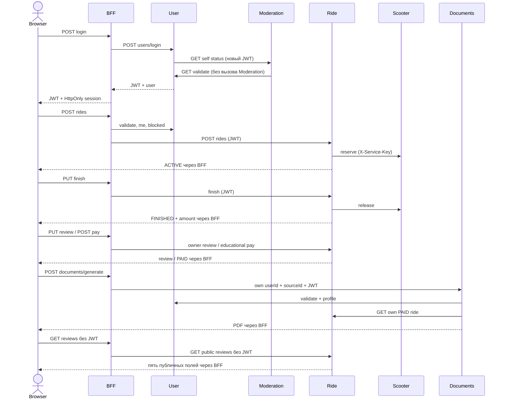

# Кикшеринг — полные REST-контракты BFF и пяти микросервисов

**Редакция: 28 октября 2026.** Сверено с финальной сборкой для преподавателя, подготовленной из присланного `bff-source-for-review.tar.gz`, с восстановленными недостающими файлами и исправлением первого медленного PDF. Это текущий самостоятельный контракт для рассылки командам и проверки. Старые предположения о `/scooter-bff`, целочисленной сетке и отсутствии отзывов не являются текущим API.

Всего **68 реализованных операций API**: BFF 26, User 13, Moderation 5, Scooter 10, Ride 9, Documents 5. Управление парком добавлено в §14. HTML-переходы, статические файлы и служебные HTTP-методы перечислены отдельно и не увеличивают это число.

Исходный документ от 16.10.2026 (@heaven) сохранён побайтово в `archive/API_CONTRACTS_ORIGINAL_2026-10-16.md` для аудита. Все 21 тема обсуждения сохранены в §10 с актуальными решениями. Предложения и внутренние SQL-поля не объявляются действующими endpoint.

Содержание: §1 адреса/архитектура; §2 протокол и доступ; §3 все маршруты; §4 DTO; §5 регистрация/вход/выход; §6 самокаты/GPS; §7 поездки/тарифы/отзывы; §8 блокировки/админка; §9 три PDF и схема данных; §10 решения 21 исходного вопроса; §11 сценарии; §12 настройки/запуск; §13 изменения/проверка.

## 1. Адреса и архитектура

| Компонент | Адрес | Назначение |
| --- | --- | --- |
| BFF + ScootX | http://localhost:8080/ | Пользовательский сайт, HTTP-сессия и прокси |
| User | http://localhost:8081 | Регистрация, JWT, профили; ADMIN-прокси в Moderation |
| Moderation | http://localhost:8082 | Блокировки; панель /admin/users.html |
| Scooter | http://localhost:8083 | Каталог, nearest, внутренние резервации |
| Ride | http://localhost:8084 | Поездки, тарифы, учебная оплата, отзывы |
| Documents | http://localhost:8085 | Генерация PDF и метаданные документов |

Все приложения развёрнуты с контекстом **`/`**, без префикса `/scooter-bff`. Имя исходного WAR не определяет URL в этом стенде: скрипт разворачивает его как ROOT.war в отдельном CATALINA_BASE. Порт PostgreSQL (например 5432 или 7689) не относится к HTTP-портам 8080–8085.

BFF вызывает User, Scooter, Ride, Documents. REST-вызовов BFF → Moderation нет: проверка блокировки идёт через User; браузер администратора использует User API, а User вызывает Moderation. Documents отдельно вызывает User/Ride/Moderation. Ride вызывает внутренние Scooter reserve/position/release.

В браузере используйте последовательно `localhost`: Cookie для localhost и 127.0.0.1 принадлежат разным хостам. Скрипты проверки могут использовать 127.0.0.1 с Bearer, это не переносит browser-сессию между хостами.

## 2. Общие правила HTTP, форматы и доступ

### 2.1 JSON, идентификаторы и время

- Для API-клиента: `Accept: application/json`. Для запроса с JSON: `Content-Type: application/json`. Успех генерации/скачивания документа возвращает PDF, а не JSON.
- Идентификаторы пользователей, поездок, тарифов, документов — UUID-строки, не числа. `numberPlate` — строка до 64 символов. Номер кодируется в URL один раз; `+` и `%` не декодируются вручную второй раз.
- Дата рождения и границы истории — `YYYY-MM-DD`. Время — ISO-8601 с Z/offset, не массив; история PDF отбирается по дате startedAt в **UTC**, обе границы включены.
- JSON-числа: целые/дробные по назначению, без NaN/Infinity и без числовых строк. Денежные суммы считаются Ride через BigDecimal, JSON amount/unlockFee/pricePerMinute — числа. Базовая валюта RUB.
- Списки обычно возвращаются непосредственно массивом, без envelopes `users`, `scooters`, `data` и т.п.; пустой результат — `[]`. `null` не равен отсутствующему объекту/ошибке.
- Примеры UUID, номеров и дат ниже иллюстрируют формат. При реальных запросах использовать значения из своих ответов API, а не ожидать существования примерного UUID.

### 2.2 JWT и сессии

Защищённый API принимает `Authorization: Bearer <JWT>`. BFF дополнительно принимает JWT своей HTTP-сессии, созданной login. Явный Authorization имеет приоритет над Cookie; неверный явный заголовок не откатывается к более привилегированной сессии. Cookie BFF — HttpOnly, JSESSIONID меняется при входе, срок бездействия устанавливается по expiresInSeconds. Cookie BFF не заменяет Bearer на прямых API других сервисов.

User подписывает **RS256**, issuer по умолчанию `scooter-user-service`. Claims: iss, sub=userId, jti (UUID токена), iat, exp, userId, role=USER/ADMIN. TTL по умолчанию 3600 секунд. User проверяет подпись/алгоритм/issuer/время, наличие пользователя, соответствие роли и запись токена/отзыв в БД. Хранится хэш токена, приватный RSA-ключ не передаётся другим сервисам.

Перед защищённым `/api/*` BFF вызывает User validate (ожидаемый успешный ответ User — 204; BFF технически принимает любой 2xx). Scooter/Ride/Moderation валидируют через User; Documents проверяет RS256 публичным ключом и также вызывает validate для немедленного отзыва. Одного декодирования JWT недостаточно. User validate **не вызывает Moderation**, поэтому нет рекурсии status → validate → status.

Публичны BFF POST register/login/logout, GET users/exists и GET reviews. У прямого User публичны POST register/login и GET exists; прямой logout требует действующий Bearer. GET reviews Ride публичен. Внутренние Scooter-операции используют X-Service-Key, а не пользовательский JWT.

Смена роли через CLI отзывает старые токены. После повышения до ADMIN нужен новый вход. Login заблокированного пользователя разрешён: blocked передаётся в профиле; запрещается новый старт, а не завершение/оплата существующей поездки.

### 2.3 Страница сервиса и реальные права

При **навигации браузера** (`Sec-Fetch-Mode: navigate` либо GET/HEAD с Accept: text/html) на служебные API показывается 403 HTML со ссылкой на сайт. Это ограничение навигации, не замена авторизации и не firewall. Вызовы fetch/Postman/curl с JSON продолжают работать в пределах прав токена.

Публичная HTML-страница панели может загружаться без ADMIN, но данные/операции защищены серверным API. Без токена её JS перенаправляет на BFF-вход, с USER показывает недостаточность прав. Пользователь вправе читать свой профиль/поездки/документы и каталог. ADMIN нужен для списка пользователей, справочников/списков блокировок и ban/unban; ADMIN не получает произвольный доступ к чужим поездкам/документам через их owner-only API.

### 2.4 Ошибки и порядок фильтров

Обычная API-ошибка — JSON-объект с `error` (строка); текст диагностический, не стабильный enum.

```json
{
  "error": "Пользователь заблокирован"
}
```

| Код | Смысл |
| --- | --- |
| 200 | Чтение/изменение/PDF успешно |
| 201 | Регистрация или старт создали объект |
| 204 | validate / logout / position / DELETE документа: без тела |
| 302 | Browser-переход login.jsp/auth/entry |
| 303 | POST /logout → login.jsp |
| 400 | Неверные данные, типы, параметры/координаты |
| 401 | Нет действующего JWT/сессии; User добавляет WWW-Authenticate |
| 403 | Недостаточно прав, чужой объект, бан старта, неверный service key/Origin; при browser navigation — HTML |
| 404 | Неизвестный путь/объект; иногда неверный UUID пути |
| 405 | Путь есть, метод не поддерживается |
| 409 | Конфликт состояния: занятый самокат, чужая резервация, незавершённая/неоплаченная поездка, иные координаты повтора |
| 413 | Превышен размер тела у User/Scooter/Ride/Documents |
| 415 | Неверный Content-Type у читаемой JSON-ручки |
| 500 | Необработанная ошибка сервиса |
| 502 | Неверный успешный ответ зависимости/структура/PDF |
| 503 | Зависимость/БД недоступна, тайм-аут, неверная конфигурация PDF/ключа |

Авторизация может сработать раньше проверки метода/параметров, поэтому запрос без JWT может вернуть 401 вместо ожидаемого 400/404/405. Browser navigation отдельно может вернуть HTML 403 ещё до JWT. У внутренних Scooter-операций отсутствие/неверный X-Service-Key даёт 403; отсутствие настройки ключа на сервере — 503.

Лимиты читаемого JSON: BFF 64 КиБ (при собственном превышении **400**), User 16 КиБ (413), Scooter/Ride/Documents 64 КиБ (413). BFF может переслать User 413 для тела меньше своего лимита. Прямой Moderation читает тело без такого прикладного лимита и не требует Content-Type на ban так же строго; нельзя описывать все парсеры как одинаковые. User/Scooter/Ride/Documents отклоняют дубли JSON-полей; BFF JSON-P/Moderation не гарантируют тот же режим. Для API, не читающего тело (например pay), эти лимиты не являются отдельной бизнес-проверкой.

BFF отклоняет изменяющие запросы с чужим Origin или Sec-Fetch-Site=cross-site (403). Для пустого DELETE тела Content-Type не нужен; непустой не-JSON в BFF — 415. User CORS по умолчанию разрешает origin панели http://localhost:8082, методы GET/POST/OPTIONS и заголовки Authorization/Content-Type/Accept. Корректный preflight — 204, запрещённый origin/метод/заголовок — 403. У остальных сервисов общего публичного CORS-шлюза нет.

### 2.5 Повторение и доступность

Автоматического банковского повторного списания нет. Повторные start не считаются идемпотентными: активная поездка уже существует → 409. Finish/pay и внутренние reserve/release имеют описанные ниже правила. При сбое проверки бана нельзя подставлять blocked=true/false; возвращается ошибка зависимости.

BFF для generate/download PDF ждёт до **60 секунд** (холодный кэш шрифтов), для метаданных Documents — 10 секунд. Прочие HTTP-клиенты используют свои ограниченные тайм-ауты. Запускной скрипт создаёт writable PDFBox/fontconfig-кэш; его не следует заменять приватными ключами или хранить в Git.

## 3. Реестр всех 60 операций API

В колонке «доступ» A — текущий пользователь; ADMIN — роль администратора; SERVICE_KEY — X-Service-Key. «A / ADMIN» у профиля/статуса означает self либо ADMIN, но не произвольного USER. BFF допускает собственную сессию вместо Bearer. `{{...}}` — подставляемые реальные значения. Для всех строк применяются §2 и предусловия состояния, а не только успешный код.

### 3.1 BFF: http://localhost:8080

| ID | Метод / путь | Доступ | Тело JSON / query | Успех | Предусловия и результат |
| --- | --- | --- | --- | --- | --- |
| E001 | POST /api/auth/register | Нет | {"login":"{{loginA}}","password":"Example-password-2026!","fullName":"Иван Петров Иванович","birthDate":"2000-05-17"} | 201 | Свободный loginA. Создан USER, пароль/hash не возвращаются; не автоматический вход |
| E002 | POST /api/auth/login | Нет | {"login":"{{loginA}}","password":"Example-password-2026!"} | 200 | Уже зарегистрирован loginA. accessToken, expiresInSeconds, user; сохранить tokenA и userA; BFF также создаёт HttpOnly JSESSIONID |
| E003 | POST /api/auth/logout | A / сессия / без токена | — | 204 | Выполнять в конце сценария, дальше нужен новый вход. Текущий JWT отозван; BFF-сессия удалена, если вызван BFF |
| E007 | GET /api/users/exists?login={{loginA}} | Нет | — | 200 | {"exists":true}; новый незанятый логин → false |
| E008 | GET /api/users/me | A | — | 200 | Профиль A, роль, дата рождения и актуальный blocked |
| E011 | GET /api/config | A | — | 200 | moderationPanelUrl=http://localhost:8082/admin/users.html |
| E012 | GET /api/rates | A | — | 200 | Активные тарифы, default, валюта, paymentMode; базовый 50 + 8/начатая минута |
| E014 | GET /api/scooters | A | — | 200 | Настоящий каталог, все статусы; удалённых нет |
| E015 | POST /api/scooters/nearest | A | {"posX":37.618423,"posY":55.751244} | 200 | Только READY; расстояния в метрах, по возрастанию; X=долгота, Y=широта |
| E016 | GET /api/scooters/{{plate}} | A | — | 200 | plate взять из реального каталога. Карточка существующего самоката |
| E020 | GET /api/rides | A | — | 200 | Только история A; статусы ACTIVE/FINISHED/PAID, review=null либо объект |
| E021 | POST /api/rides | A | {"numberPlate":"{{plate}}","posX":37.618423,"posY":55.751244} | 201 | READY plate; нет другой активной поездки у A/самоката; A не заблокирован. Начата одна ACTIVE-поездка, самокат IN_RIDE; сохранить rideId |
| E022 | PUT /api/rides/{{rideId}}/position | A | {"posX":37.618423,"posY":55.751244} | 204 | Своя ACTIVE-поездка. Сохранена последняя позиция и обновлена позиция занятого самоката |
| E023 | PUT /api/rides/{{rideId}}/finish | A | {"posX":37.618423,"posY":55.751244} | 200 | Своя ACTIVE-поездка; повтор допустим с теми же координатами. FINISHED, конечные координаты, длительность и сумма; самокат освобождён |
| E024 | PUT /api/rides/{{rideId}}/review | A | {"rideRating":5,"scooterRating":4,"rideComment":"Хорошая поездка","scooterComment":"Удобный самокат"} | 200 | Своя FINISHED или PAID-поездка. Отзыв сохранён в Ride DB и возвращается в истории; повтор изменяет его |
| E025 | POST /api/rides/{{rideId}}/pay | A | {} | 200 | Своя FINISHED-поездка, PAYMENT_MODE=educational. PAID и paidAt, paymentMode=EDUCATIONAL; сумма не меняется; повтор идемпотентен |
| E032 | POST /api/documents/generate | A | {"docType":"RIDE_PAYMENT","sourceId":"{{rideId}}"} | 200 | Для чека: своя PAID-поездка; другие типы и тела см. ниже. Настоящий PDF, application/pdf, %PDF-, корректная кириллица; метаданные GENERATED |
| E033 | GET /api/documents?limit=50&offset=0 | A | — | 200 | Только свои неудалённые метаданные, максимум limit; сохранить documentId |
| E034 | GET /api/documents/{{documentId}} | A | — | 200 | Метаданные существующего своего документа |
| E035 | GET /api/documents/{{documentId}}/download | A | — | 200 | Свой GENERATED-документ. PDF заново построен из сохранённого снимка данных, не JSON и не HTML |
| E036 | DELETE /api/documents/{{documentId}} | A | — | 204 | Выполнять после скачивания и проверки снимка. Мягкое удаление, повтор DELETE тоже 204; GET/download затем 404 |
| E059 | GET /api/reviews?limit=20&offset=0 | Нет | — | 200 | Нужна миграция отзывов 002; пустой список допустим. Публичный массив оценок, комментариев и reviewedAt; нет userId, rideId, логинов, сумм и координат |

### 3.2 User: http://localhost:8081

| ID | Метод / путь | Доступ | Тело JSON / query | Успех | Предусловия и результат |
| --- | --- | --- | --- | --- | --- |
| E004 | POST /api/users/register | Нет | {"login":"{{loginA}}","password":"Example-password-2026!","fullName":"Иван Петров Иванович","birthDate":"2000-05-17"} | 201 | Свободный loginA. Создан USER, пароль/hash не возвращаются; не автоматический вход |
| E005 | POST /api/users/login | Нет | {"login":"{{loginA}}","password":"Example-password-2026!"} | 200 | Уже зарегистрирован loginA. accessToken, expiresInSeconds, user; сохранить tokenA и userA; BFF также создаёт HttpOnly JSESSIONID |
| E006 | POST /api/users/logout | A | — | 204 | Выполнять в конце сценария, дальше нужен новый вход. Текущий JWT отозван; BFF-сессия удалена, если вызван BFF |
| E009 | GET /api/users/exists?login={{loginA}} | Нет | — | 200 | {"exists":true}; новый незанятый логин → false |
| E010 | GET /api/users/me | A | — | 200 | Профиль A, роль, дата рождения и актуальный blocked |
| E042 | GET /api/users/validate | A | — | 204 | 204, без тела, токен действителен; не обращается к Moderation |
| E043 | GET /api/users | ADMIN | — | 200 | Список активных пользователей: id, login, fullName |
| E044 | GET /api/users/{{userA}} | A / ADMIN | — | 200 | Полный профиль A; USER B не имеет доступа |
| E045 | GET /api/users/{{userA}}/blocked | A / ADMIN | — | 200 | {"blocked":false/true} |
| E046 | GET /api/users/blocked?limit=50&offset=0 | ADMIN | — | 200 | Список блокировок из Moderation |
| E047 | GET /api/users/reasons | ADMIN | — | 200 | Справочник причин: reasonType, description, durationSeconds |
| E048 | POST /api/users/{{userA}}/ban | ADMIN | {"reason":"{{reason}}"} | 200 | Существующий тестовый userA; reason взять из справочника. Актуальный BlockStatus; повтор не создаёт вторую блокировку/не продлевает старую |
| E049 | POST /api/users/{{userA}}/unban | ADMIN | — | 200 | Существующий тестовый userA; reason взять из справочника. blocked=false; повтор допустим |

### 3.3 Moderation: http://localhost:8082

| ID | Метод / путь | Доступ | Тело JSON / query | Успех | Предусловия и результат |
| --- | --- | --- | --- | --- | --- |
| E050 | GET /api/moderation/users/{{userA}}/status | A / ADMIN | — | 200 | BlockStatus: userId, blocked, reasonType, reason, blockedAt, blockedUntil |
| E051 | GET /api/moderation/reasons | ADMIN | — | 200 | Справочник причин |
| E052 | GET /api/moderation/users?blocked=true&limit=50&offset=0 | ADMIN | — | 200 | Список блокировок |
| E053 | POST /api/moderation/users/{{userA}}/ban | ADMIN | {"reason":"{{reason}}"} | 200 | Использовать реальный тестовый userA. Прямой Moderation не проверяет наличие UUID в User. BlockStatus; blocked=true |
| E054 | POST /api/moderation/users/{{userA}}/unban | ADMIN | — | 200 | Использовать реальный тестовый userA. Прямой Moderation не проверяет наличие UUID в User. BlockStatus; blocked=false |

### 3.4 Scooter: http://localhost:8083

| ID | Метод / путь | Доступ | Тело JSON / query | Успех | Предусловия и результат |
| --- | --- | --- | --- | --- | --- |
| E017 | GET /api/scooters | A | — | 200 | Настоящий каталог, все статусы; удалённых нет |
| E018 | POST /api/scooters/nearest | A | {"posX":37.618423,"posY":55.751244} | 200 | Только READY; расстояния в метрах, по возрастанию; X=долгота, Y=широта |
| E019 | GET /api/scooters/{{plate}} | A | — | 200 | plate взять из реального каталога. Карточка существующего самоката |
| E056 | POST /api/scooters/{{internalPlate}}/reserve | SERVICE_KEY | {"rideId":"{{internalRideId}}","userId":"{{userA}}"} | 200 | Только отдельный тестовый самокат и отдельный UUID, не связанный с настоящей Ride-поездкой; порядок reserve → position → release. Резервирование |
| E057 | POST /api/scooters/{{internalPlate}}/position | SERVICE_KEY | {"rideId":"{{internalRideId}}","posX":37.618423,"posY":55.751244} | 200 | Только отдельный тестовый самокат и отдельный UUID, не связанный с настоящей Ride-поездкой; порядок reserve → position → release. Позиция обновлена |
| E058 | POST /api/scooters/{{internalPlate}}/release | SERVICE_KEY | {"rideId":"{{internalRideId}}","posX":37.618423,"posY":55.751244} | 200 | Только отдельный тестовый самокат и отдельный UUID, не связанный с настоящей Ride-поездкой; порядок reserve → position → release. Резервация закрыта, самокат освобождён |

### 3.5 Ride: http://localhost:8084

| ID | Метод / путь | Доступ | Тело JSON / query | Успех | Предусловия и результат |
| --- | --- | --- | --- | --- | --- |
| E013 | GET /api/rates | A | — | 200 | Активные тарифы, default, валюта, paymentMode; базовый 50 + 8/начатая минута |
| E026 | GET /api/rides | A | — | 200 | Только история A; статусы ACTIVE/FINISHED/PAID, review=null либо объект |
| E027 | POST /api/rides | A | {"numberPlate":"{{plate}}","posX":37.618423,"posY":55.751244} | 201 | READY plate; нет другой активной поездки у A/самоката; A не заблокирован. Начата одна ACTIVE-поездка, самокат IN_RIDE; сохранить rideId |
| E028 | PUT /api/rides/{{rideId}}/position | A | {"posX":37.618423,"posY":55.751244} | 204 | Своя ACTIVE-поездка. Сохранена последняя позиция и обновлена позиция занятого самоката |
| E029 | PUT /api/rides/{{rideId}}/finish | A | {"posX":37.618423,"posY":55.751244} | 200 | Своя ACTIVE-поездка; повтор допустим с теми же координатами. FINISHED, конечные координаты, длительность и сумма; самокат освобождён |
| E030 | PUT /api/rides/{{rideId}}/review | A | {"rideRating":5,"scooterRating":4,"rideComment":"Хорошая поездка","scooterComment":"Удобный самокат"} | 200 | Своя FINISHED или PAID-поездка. Отзыв сохранён в Ride DB и возвращается в истории; повтор изменяет его |
| E031 | POST /api/rides/{{rideId}}/pay | A | {} | 200 | Своя FINISHED-поездка, PAYMENT_MODE=educational. PAID и paidAt, paymentMode=EDUCATIONAL; сумма не меняется; повтор идемпотентен |
| E055 | GET /api/rides/{{rideId}} | A | — | 200 | Одна своя поездка; B → 403 |
| E060 | GET /api/reviews?limit=20&offset=0 | Нет | — | 200 | Нужна миграция отзывов 002; пустой список допустим. Публичный массив оценок, комментариев и reviewedAt; нет userId, rideId, логинов, сумм и координат |

### 3.6 Documents: http://localhost:8085

| ID | Метод / путь | Доступ | Тело JSON / query | Успех | Предусловия и результат |
| --- | --- | --- | --- | --- | --- |
| E037 | POST /api/documents/generate | A | {"userId":"{{userA}}","docType":"RIDE_PAYMENT","sourceId":"{{rideId}}"} | 200 | Для чека: своя PAID-поездка; другие типы и тела см. ниже. Настоящий PDF, application/pdf, %PDF-, корректная кириллица; метаданные GENERATED |
| E038 | GET /api/documents?limit=50&offset=0 | A | — | 200 | Только свои неудалённые метаданные, максимум limit; сохранить documentId |
| E039 | GET /api/documents/{{documentId}} | A | — | 200 | Метаданные существующего своего документа |
| E040 | GET /api/documents/{{documentId}}/download | A | — | 200 | Свой GENERATED-документ. PDF заново построен из сохранённого снимка данных, не JSON и не HTML |
| E041 | DELETE /api/documents/{{documentId}} | A | — | 204 | Выполнять после скачивания и проверки снимка. Мягкое удаление, повтор DELETE тоже 204; GET/download затем 404 |

### 3.7 Важные различия маршрутов

- BFF GET /api/rides — только список текущего пользователя. GET /api/rides/{id} существует **у Ride**, у BFF такого GET нет (404).
- У BFF нет ADMIN-прокси /api/users/{id}/ban/unban и списка всех users; панель работает напрямую через **User 8081**. На User эти ручки реализованы.
- BFF GET /api/scooters поддерживает только status=READY или available=true как фильтр свободных; другие status не передаёт и не отклоняет, а возвращает общий каталог. У Scooter доступны READY/IN_RIDE/CHARGING/REPAIR, неверный status — 400.
- BFF POST documents/generate берёт userId из me, не доверяет userId тела. Для USER_BLOCKED/USER_HISTORY sourceId игнорируется и передаётся null. Прямой Documents требует свой userId в теле и отклоняет sourceId у неплатёжных типов (400).
- GET /api/config защищён. Общего публичного исключения /api/auth/* нет. POST BFF logout без JWT допустим; прямой User logout с отозванным JWT — 401.
- HTML/страницы и скрытые SQL-поля не увеличивают число API-операций. PUT scooter/status, изменение профиля, удаление аккаунта, CRUD тарифов/самокатов, загрузка фото парковки и банковская платёжная ручка не реализованы.

## 4. Поля ответов и полные JSON-примеры

### 4.1 User, LoginResponse, UserSummary

```json
{
  "id": "550e8400-e29b-41d4-a716-446655440000",
  "login": "ivan.petrov",
  "role": "USER",
  "fullName": "Иван Петров Иванович",
  "birthDate": "2000-05-17",
  "avatarUrl": null,
  "deleted": false,
  "blocked": false
}
```

User: id UUID, login/fullName строки, role USER/ADMIN, birthDate date, avatarUrl string|null, deleted/blocked boolean. Пароль и passwordHash не возвращаются. blocked получен из Moderation, не хранится в User DB. USER не может читать чужой профиль; ADMIN может читать существующий активный профиль.

```json
{
  "accessToken": "<JWT>",
  "expiresInSeconds": 3600,
  "user": {
    "id": "550e8400-e29b-41d4-a716-446655440000",
    "login": "ivan.petrov",
    "role": "USER",
    "fullName": "Иван Петров Иванович",
    "birthDate": "2000-05-17",
    "avatarUrl": null,
    "deleted": false,
    "blocked": false
  }
}
```

UserSummary в ADMIN-списке: только id, login, fullName. Список не является выгрузкой паролей/дат рождения/токенов.

```json
[
  {
    "id": "550e8400-e29b-41d4-a716-446655440000",
    "login": "ivan.petrov",
    "fullName": "Иван Петров Иванович"
  }
]
```

### 4.2 Scooter и Rate

```json
{
  "numberPlate": "A111AA77",
  "charge": 95,
  "status": "READY",
  "posX": 37.618423,
  "posY": 55.751244,
  "distance": 125.4
}
```

charge — целое 0–100; status — READY/IN_RIDE/CHARGING/REPAIR. posX/posY — числа. distance — число метров только для nearest; в обычной карточке/каталоге может присутствовать null. SQL-имена numeric_plate/position_x/position_y не являются wire-полями.

```json
[
  {
    "id": "6ba7b810-9dad-11d1-80b4-00c04fd430c8",
    "name": "Учебный поминутный",
    "unlockFee": 50.0,
    "pricePerMinute": 8.0,
    "currency": "RUB",
    "default": true,
    "paymentMode": "EDUCATIONAL"
  }
]
```

Rate возвращает активные тарифы. default boolean; не isDefault. paymentMode EDUCATIONAL при PAYMENT_MODE=educational, иначе DISABLED. Один активный default. Произвольный rateId выбирает только существующий активный тариф, иначе 404.

### 4.3 Ride и приватный отзыв

```json
{
  "id": "7c9e6679-7425-40de-944b-e07fc1f90ae7",
  "userId": "550e8400-e29b-41d4-a716-446655440000",
  "numberPlate": "A111AA77",
  "rateId": "6ba7b810-9dad-11d1-80b4-00c04fd430c8",
  "status": "PAID",
  "paymentMode": "EDUCATIONAL",
  "startedAt": "2026-10-28T12:00:00Z",
  "finishedAt": "2026-10-28T12:01:00Z",
  "startPosX": 37.618423,
  "startPosY": 55.751244,
  "endPosX": 37.619,
  "endPosY": 55.752,
  "lastPosX": 37.6188,
  "lastPosY": 55.7518,
  "lastPositionAt": "2026-10-28T12:00:30Z",
  "durationSeconds": 60,
  "amount": 58.0,
  "currency": "RUB",
  "paidAt": "2026-10-28T12:01:10Z",
  "review": {
    "rideRating": 5,
    "scooterRating": 4,
    "rideComment": "Удобная поездка",
    "scooterComment": "Хороший самокат",
    "reviewedAt": "2026-10-28T12:02:00Z"
  }
}
```

id/userId/rateId — UUID; numberPlate/status/currency/paymentMode — строки. Время — строки ISO-8601 или null. Координаты — number|null. durationSeconds — целое|null; amount — number|null. До завершения finishedAt/endPos/durationSeconds/amount/paidAt могут быть null; до первой позиции lastPos/lastPositionAt могут быть null; до первого отзыва review=null. На FINISHED paidAt=null. Тарифный снимок unlockFee/pricePerMinute хранится внутренне, в Ride JSON не раскрывается. Объект ошибки не должен интерпретироваться как поездка.

### 4.4 PublicReview (без идентификаторов)

GET /api/reviews BFF/Ride возвращает непосредственно массив:

```json
[
  {
    "rideRating": 5,
    "scooterRating": 4,
    "rideComment": "Удобная поездка",
    "scooterComment": "Хороший самокат",
    "reviewedAt": "2026-10-28T12:02:00Z"
  }
]
```

Ровно пять полей: rideRating, scooterRating — int 1–5; rideComment, scooterComment — строки (пустая допустима, для legacy-записей возможен null); reviewedAt — ISO-8601. Нет userId/rideId/логина/имени/номера/координат/суммы. Сортировка reviewedAt DESC, внутренний id DESC при равенстве. Публичны сохранённые отзывы FINISHED/PAID. Комментарий является пользовательским текстом; UI его экранирует. Автор на главной — «Пользователь ScootX».

### 4.5 BlockStatus и Reason

```json
{
  "userId": "550e8400-e29b-41d4-a716-446655440000",
  "blocked": true,
  "reasonType": "RIDE_DANGEROUS",
  "reason": "Агрессивное / опасное вождение",
  "blockedAt": "2026-10-28T12:00:00Z",
  "blockedUntil": "2026-11-04T12:00:00Z"
}
```

При blocked=false reasonType/reason/blockedAt/blockedUntil равны null. Для бессрочного действующего бана blockedUntil=null. В запросе ban поле reason — **reasonType**, не описание.

```json
[
  {
    "reasonType": "RIDE_DANGEROUS",
    "description": "Агрессивное / опасное вождение",
    "durationSeconds": 604800
  }
]
```

### 4.6 DocumentMetadata

```json
{
  "id": "df2f1b4a-f284-4a94-b0e2-03b75490ab1e",
  "userId": "550e8400-e29b-41d4-a716-446655440000",
  "docType": "RIDE_PAYMENT",
  "sourceId": "7c9e6679-7425-40de-944b-e07fc1f90ae7",
  "from": null,
  "to": null,
  "status": "GENERATED",
  "createdAt": "2026-10-28T12:03:00Z",
  "generatedAt": "2026-10-28T12:03:01Z",
  "snapshotAvailable": true
}
```

id/userId/sourceId — UUID (sourceId nullable). from/to — date|null. status=PENDING/GENERATED/FAILED. createdAt — время, generatedAt nullable. snapshotAvailable означает наличие JSON-снимка исходных данных, а не сохранённого PDF-файла. Временные внутренние updated_at/deleted_at не обязаны публиковаться в DTO.

## 5. Регистрация, вход, browser-переходы и выход

### 5.1 Регистрация

POST BFF /api/auth/register либо прямой User /api/users/register. Обязательны login, password, fullName, birthDate. avatarUrl необязателен/null. BFF проверяет и пересылает поля, роль не передаёт; User всегда создаёт USER. Регистрация не создаёт BFF-сессию, ScootX после неё отдельно вызывает login.

- login: trim и lower-case Locale.ROOT на сервере, 3–64 ASCII `[a-z0-9_.-]`, уникален после нормализации. Неверный → 400, занятый → 409.
- password: при регистрации минимум 8 единиц UTF-16 (Java/JS length), максимум **72 байта UTF-8**, без NUL; при login нет требования длины 8, но действуют непустота/NUL/байтовый предел. Bcrypt, cost по умолчанию 12. Повтор пароля — только клиентское поле confirm, в API не требуется.
- fullName: до 200 символов после trim, без ISO-control; 2–4 слова с одним пробелом между словами, минимум 2 буквы в каждом слове. Компонент: заглавная + строчные; дефис и прямой/типографский апостроф допускаются между такими компонентами. Один алфавит на всё ФИО — кириллица либо латиница, без смешения. Примеры: Иван Петров, Анна-Мария Петрова, John O’Connor. Это проверка формата, а не проверка подлинности личности/имени.
- birthDate: ISO date, не ранее 1900-01-01 и **не позже today(UTC) minus 16 years**. Ровно 16 лет разрешено, младше — 400. Проверяется в UI, BFF и User. Старые аккаунты автоматически не переписываются.
- avatarUrl: null/пустая строка → отсутствует; иначе максимум 2048, абсолютный http/https с host, без userInfo. Передача URL не означает загрузку файла аватара сервером.

Запрос:

```json
{
  "login": "ivan.petrov",
  "password": "Example-password-2026!",
  "fullName": "Иван Петров Иванович",
  "birthDate": "2000-05-17",
  "avatarUrl": null
}
```

Ответ 201 — User из §4.1. Login 200 — LoginResponse. Неверный логин/пароль при входе, удалённый пользователь → 401; недоступность Moderation/БД при login → ошибка, не ложный успешный вход. User сначала сохраняет токен, читает status в Moderation и при сбое отзывает новый токен.

### 5.2 URL и действующая сессия

| URL BFF | Поведение |
| --- | --- |
| GET / | Главная ScootX |
| GET /index.jsp | Главная ScootX |
| GET /login.jsp | 302 → /auth/entry |
| GET /auth/entry | Проверка текущего Bearer/сессии: без действующей авторизации → /?auth=login; USER → /?account=profile; ADMIN → панель с JWT во fragment |
| GET /register.jsp | 302 → /?auth=register |
| GET /main.jsp | 302 → /?account=profile |
| GET /?auth=login | Без сессии форма входа; USER кабинет; ADMIN переходит через /auth/entry в панель |
| GET /?auth=register | Форма регистрации |
| GET /?account=profile\|rides\|saved\|documents | Соответствующий диалог при входе, иначе форма входа |
| /#home, /#scooters, /#performance, /#support | Якоря одной HTML-страницы, не отдельные API |
| GET /logout | HTML-подтверждение выхода, без отзыва JWT |
| POST /logout | Отзыв текущего токена и закрытие BFF-сессии, 303 → login.jsp |

При успешном POST login пользователь USER остаётся в BFF, ADMIN перенаправляется браузером на:

`http://localhost:8082/admin/users.html#accessToken=<encodeURIComponent(JWT)>`

Точный адрес берётся из GET /api/config (`moderationPanelUrl`). Панель сохраняет токен в sessionStorage и удаляет fragment. В URL query и localStorage BFF JWT не кладётся. При повторном login.jsp действующая сессия не удаляется и JWT не отзывается. Чтобы сменить USER на другой аккаунт/ADMIN, сначала выйти либо использовать отдельный профиль браузера.

### 5.3 Выход

BFF POST /api/auth/logout либо POST /logout вызывает User POST /api/users/logout с текущим JWT и всегда закрывает свою сессию. При успехе API — 204; повтор BFF без токена допустим (204). Если User ответил 401, токен уже непригоден — BFF считает выход завершённым. Если отзыв не подтверждён из-за ошибки/недоступности User, BFF возвращает ошибку и явно не утверждает успешный общий отзыв, хотя локальная сессия закрыта. GET /api/auth/logout с действующим JWT — 405 (без него раньше может быть 401).

Панель вызывает прямой User logout и при успехе/уже недействующем токене очищает sessionStorage, идёт на BFF login.jsp. При сетевом сбое показывает ошибку и позволяет повторить. User logout отзывает текущий токен, а не все сессии всех устройств. Все защищённые сервисы учитывают отзыв через validate. Повышение роли штатным CLI отдельно отзывает старые токены аккаунта.

## 6. Самокаты, GPS и внутренние операции

### 6.1 Координаты и nearest

Согласованное значение **posX = longitude (долгота), posY = latitude (широта), градусы**. Nearest требует оба конечных JSON-числа: X от -180 до 180, Y от -90 до 90. Расстояние — Haversine с R=6371008.8 м, по возрастанию; при равенстве — numberPlate. В UI <1000 м отображаются метры, дальше километры. Только READY, автоматического радиуса отсечения нет.

В BFF общая числовая проверка координат и в Ride/внутренних position/release исторически допускают конечные числа до ±1000000; **это предел реализации, не единицы сетки и не расстояние в метрах**. Строгие GPS-границы применяет nearest, клиент передаёт валидные GPS. Полного геозонирования/подтверждения реальной парковки/маршрута нет. Некорректные сохранённые GPS при nearest → 503 вместо ложного расстояния. Примерные старые SQL-координаты интерпретируются как географические точки; автоматического перемещения к пользователю нет.

Нормальный GET /api/scooters — все неудалённые состояния; нет скрытого создания случайных самокатов. 404 карточки — нет/удалён. Старые numericPlate/positionX/positionY/envelopes не wire-контракт.

### 6.2 Отказ в разрешении

При разрешении геолокации каталог запрашивает nearest автоматически. При отказе, недоступности, тайм-ауте — GET общего каталога, без расстояний/сортировки по близости; сообщение причины и кнопка повторной геолокации. Ручных полей X/Y и старой кнопки «Найти по координатам» нет.

Старт без GPS берёт актуальную позицию выбранного READY-самоката из его карточки. Завершение сначала пробует GPS; при ошибке пользователь может отдельно подтвердить последнюю сохранённую позицию поездки (lastPos, иначе startPos). Отмена подтверждения ничего не завершает; без сохранённой валидной позиции этот вариант недоступен. Это не выдаётся за измерение фактической позиции. Повтор finish после потерянного ответа использует ту же первую позицию.

### 6.3 Reserve / position / release

Доступ только с `X-Service-Key: <общий SERVICE_API_KEY>`. Ride вызывает их напрямую; браузер ключ не получает. Это исключение из передачи пользовательского Bearer: восстановление операции должно работать после его отзыва.

Reserve body:

```json
{
  "rideId": "7c9e6679-7425-40de-944b-e07fc1f90ae7",
  "userId": "550e8400-e29b-41d4-a716-446655440000"
}
```

Position body:

```json
{
  "rideId": "7c9e6679-7425-40de-944b-e07fc1f90ae7",
  "posX": 37.619,
  "posY": 55.752
}
```

Release body:

```json
{
  "rideId": "7c9e6679-7425-40de-944b-e07fc1f90ae7",
  "posX": 37.619,
  "posY": 55.752
}
```

Для release координаты необязательны, но обе либо ни одной. Возвращается 200 с текущим Scooter. Reserve: атомарно READY → IN_RIDE, заряд должен быть >0; занято/не READY/несовместимая операция → 409. Position допустим только на текущем IN_RIDE и с его reservation_id, иначе 409. Release переводит собственную резервацию в READY и сохраняет конечные координаты.

Повтор того же reserve идемпотентен; другой user/plate для того же rideId — 409. Постоянные tombstones в scooter_reservations предотвращают поздний reserve после отмены. Повтор release не освобождает новую резервацию; release до запоздалого reserve закрывает операцию, поздний reserve — 409. Неверные UUID/типы/неполная пара — 400. Использовать реальные номера; неизвестная карточка может дать 404. Расход батареи автоматически по расстоянию не имитируется.

## 7. Поездки, тарифы, оплата и отзывы

### 7.1 Старт и время

numberPlate обязателен; rateId — UUID|null, null выбирает активный default. В API start posX/posY допускают null, UI передаёт валидную пару из GPS/карточки. userId из тела не назначает владельца: он берётся из JWT. BFF перед стартом запрашивает User me/blocked; при blocked/deleted — запрет, при недоступной проверке — ошибка. Прямой Ride тоже проверяет бан при старте.

Одна активная операция на пользователя и самокат обеспечена уникальными индексами и резервированием. Повторный start не создаёт новую поездку поверх существующей, возвращается 409. Несуществующий активный тариф — 404, неизвестный самокат — 404, занятый/разряженный — 409. startedAt фиксируется сервером после успешного резервирования.

Внешние состояния: **ACTIVE → FINISHED → PAID**. В SQL есть STARTING/CANCELLING/FINISHING для восстановления: они не являются новым пользовательским CANCELLED. Список скрывает STARTING/CANCELLING; FINISHING сериализуется как ACTIVE, запрос завершения может ещё обрабатываться. Фоновое восстановление повторяет отмену/освобождение, не создавая двойную аренду.

### 7.2 Position / finish

Position owner-only и только ACTIVE, успех 204. Сохраняет lastPosX/lastPosY/lastPositionAt и обновляет текущий Scooter служебной ручкой. Истории всех точек маршрута нет.

Finish owner-only, обе конечные координаты обязательны. Первый запрос фиксирует finishedAt/endPos/durationSeconds/amount, переводит операцию во внутренний FINISHING и освобождает Scooter. Длительность округляется вверх до целой секунды, не отрицательна. После успешного освобождения — FINISHED. При сбое освобождения повтор/recovery использует уже зафиксированные время/сумму. На FINISHED/PAID повтор с теми же координатами — 200, с другими — 409. Чужая поездка — 403, корректный неизвестный UUID — 404; неверный UUID пути обычно 404 (у BFF review возможен 400).

### 7.3 Оплата

Учебный тариф: unlockFee=50 RUB, pricePerMinute=8 RUB; снимок тарифа сохраняется на старте. minutes=max(1,ceil(durationSeconds/60)), amount=unlockFee+minutes*pricePerMinute, округление до 2 знаков HALF_UP. 0–60 секунд — 58 RUB, 61–120 — 66 RUB. Изменение rates не меняет уже записанный снимок старой поездки.

Pay owner-only, FINISHED → PAID; paidAt фиксируется один раз, повтор PAID → 200 с прежней суммой/временем. ACTIVE pay → 409. PAYMENT_MODE=educational обязателен для успешной учебной оплаты; иначе 503, статус остаётся FINISHED. Поля amount/status клиента не назначают оплату. **Реального банковского провайдера/списания нет**, paymentMode=EDUCATIONAL честно сохраняется в API/PDF, даже если надпись убрана из формы UI. Произвольный бан не снимается автоматически после оплаты.

История owner-only, новые поездки первыми. Direct Ride query userId можно опустить (текущий), чужой userId → 403. BFF игнорирует клиентский userId и сам получает текущий. ADMIN не обходит owner-only Ride. Полная поездка GET id доступна Documents напрямую через Ride, но не как GET одной поездки в BFF.

### 7.4 Сохранение отзыва и публичная лента

PUT review owner-only на FINISHED/PAID; ACTIVE/другие состояния → 409. Тело:

```json
{
  "rideRating": 5,
  "scooterRating": 4,
  "rideComment": "Удобная поездка",
  "scooterComment": "Хороший самокат"
}
```

Обе оценки обязательны, строго целые 1–5; 1.5, строки, null/отсутствие — 400. Комментарии необязательны/null → пустая строка, trim, максимум 1000 UTF-16-символов каждый; ISO-control, кроме LF/CR/TAB, запрещён. Текст не определяет userId/rideId/время; reviewedAt ставит сервер.

Ответ 200 — Ride с review (§4.3). Один изменяемый отзыв на поездку, повтор PUT заменяет его, не создаёт дубликат. Отзыв хранится в rides, переживает перезапуск. Доступ по чужому rideId — 403.

Публичные GET reviews BFF/Ride: limit default20, 1–100; offset default0, 0..2147483647. Неверная пагинация — 400. Нет JWT, нет userId-фильтра, нет персональных полей; ответ PublicReview[] (§4.4). Главная показывает последние два, «Все отзывы» — страницы по20; сохранение/изменение обновляет ленту. Пустой список и ошибка имеют явные состояния, демонстрационных отзывов вместо них нет. Публичного POST reviews/delete review/отдельной модерации отзывов в этой версии нет.

## 8. Moderation, User-прокси и панель ADMIN

Источник blocked — Moderation. User хранит пользователей/роли, но не копирует бан в свою таблицу. User me/byId/blocked и login спрашивают status с исходным Bearer. При новом register новый UUID ещё не имеет банов, blocked=false без запроса status. User validate не вызывает Moderation.

Status доступен self либо ADMIN, остальные Moderation API — ADMIN. Неизвестный userId без записи в прямом Moderation status даёт 200 blocked=false, не 404: сервис сам не проверяет наличие пользователя в User. User-прокси byId/ban/unban/blocked проверяет существующего активного пользователя и может дать 404.

Ban reason — enum-имя из reasons. Неизвестное/пустое — 400. Срок задаётся причиной, blockedUntil=blockedAt+duration либо null навсегда. Повтор активного ban возвращает существующий объект, не меняет причину/срок. Unban удаляет текущую запись; повтор — 200 blocked=false. Истории прошлых банов в API нет.

При истечении срока status снимает запись и отвечает false. Список читает записи отдельно, поэтому запись может кратковременно оставаться до проверки истечения её статуса; не следует обещать отдельный мгновенный scheduler. GET списка: limit default50, 1–500; offset default0 ≥0; blocked либо отсутствует, либо строго true. User-прокси /blocked имеет default limit100, тот же максимум500.

Панель `/admin/users.html` получает `/admin/js/config.js` (USER_URL и LOGIN_URL без секретов), затем вызывает User GET users, blocked постранично, reasons, POST ban/unban. CORS origin8082 разрешён в User. Вход/выход и токен см. §5. Нет прямого BFF ADMIN-прокси. Служебный key Scooter не превращается в ADMIN JWT и не используется для User → Moderation.

### Справочник причин исходной согласованной схемы

GET reasons — источник актуальных имён для клиента. В текущем коде сроки ban заданы BlockReason; SQL-справочник должен оставаться согласован с ним. Публичного API редактирования причин нет.

| reasonType | Описание | durationSeconds (null — навсегда) |
| --- | --- | --- |
| RIDE_DOUBLE_RIDING | Езда вдвоем или втроем | 259200 |
| RIDE_UNDERAGE | Передача самоката несовершеннолетнему | NULL |
| RIDE_INTOXICATED | Езда в состоянии опьянения | NULL |
| RIDE_DANGEROUS | Агрессивное / опасное вождение | 604800 |
| RIDE_ACCIDENT_WITH_PEDESTRIAN | Наезд на пешехода / ДТП | NULL |
| VANDALISM_PHYSICAL | Умышленная порча техники | NULL |
| STOLEN_OR_ABANDONED | Попытка кражи или удержания техники | NULL |
| HEAVY_OVERLOAD | Превышение допустимой нагрузки | 259200 |
| PARKING_BLOCKED_PEDESTRIAN | Парковка, создающая препятствия | 86400 |
| PARKING_FORBIDDEN_ZONE | Оставление в запрещенной зоне | 172800 |
| PARKING_FAKE_PHOTO | Фиктивное / некачественное фото парковки | 43200 |
| PAYMENT_DEBT | Неоплаченная задолженность | NULL |
| PAYMENT_CHARGEBACK_FRAUD | Оспаривание платежей через банк | NULL |
| PAYMENT_INVALID_CARD | Использование подозрительных карт | NULL |
| ACCOUNT_MULTI_ACCOUNTING | Мультиаккаунтинг | NULL |
| ACCOUNT_FAKE_IDENTITY | Использование чужих документов | NULL |
| ACCOUNT_TRANSFER | Передача аккаунта третьим лицам | 604800 |
| SERVICE_ABUSE_SUPPORT | Оскорбление службы поддержки | 604800 |
| SERVICE_API_ABUSE | Попытка взлома / использование ботов | NULL |

User → Moderation сохраняет 400/401/403/409. Сеть/тайм-аут/429/5xx → 503; неверный успешный JSON/userId/blocked, неожиданный redirect/404 → 502. Недоступность не превращается в выдуманный бан. Moderation перед каждым защищённым запросом проверяет исходный JWT через User validate (ожидает204); плохой/отозванный →401, недоступная проверка →503.

## 9. Три вида PDF, метаданные и данные БД

### 9.1 Запрос BFF и прямой Documents

**RIDE_PAYMENT** — чек только своей PAID-поездки:

```json
{
  "docType": "RIDE_PAYMENT",
  "sourceId": "7c9e6679-7425-40de-944b-e07fc1f90ae7"
}
```

**USER_HISTORY** — история по startedAt в выбранном периоде UTC:

```json
{
  "docType": "USER_HISTORY",
  "from": "2026-10-01",
  "to": "2026-10-28"
}
```

**USER_BLOCKED** — уведомление о текущей действующей блокировке:

```json
{
  "docType": "USER_BLOCKED"
}
```

На прямом Documents необходимо добавить собственный userId; BFF получает его из me:

```json
{
  "userId": "550e8400-e29b-41d4-a716-446655440000",
  "docType": "RIDE_PAYMENT",
  "sourceId": "7c9e6679-7425-40de-944b-e07fc1f90ae7"
}
```

RECEIPT — совместимый alias RIDE_PAYMENT. У чека sourceId обязателен; у остальных типов прямой Documents требует null/отсутствие sourceId. USER_HISTORY требует обе корректные даты и from≤to. Неверный docType/тип UUID/даты →400; чужой userId/чужая поездка →403. Без JWT →401. Пустая история допустима: возвращается PDF без выдуманных поездок.

Чек: Documents получает User и Ride GET id, требует собственного владельца, PAID, id/userId/numberPlate/startedAt/finishedAt/amount/currency/paidAt; amount≥0, currency из3 заглавных латинских букв, startedAt≤finishedAt≤paidAt. Чужой →403, неоплаченный →409, неполный/несовместимый успешный ответ источника →502.

Уведомление: status через Moderation с JWT текущего пользователя, blocked=true обязателен. Без действующего бана →409. ID блокировки не нужен; причина/срок идут из status, blockedUntil=null корректен для бессрочного бана. История: User + Ride history текущего пользователя, фильтр по UTC-дате startedAt включительно; может содержать ACTIVE/FINISHED с ещё пустыми полями оплаты.

### 9.2 Успех и ошибки PDF

Успех — 200, Content-Type: application/pdf, Content-Disposition: attachment. BFF имя document.pdf; прямой Documents generate — ride_payment.pdf/user_history.pdf/user_blocked.pdf, повторный download — document.pdf. Тело начинается с `%PDF-`, это бинарный документ. BFF отклоняет не-PDF успешный ответ зависимости как502. Ошибка — JSON с error, не PDF-файл с HTML/JSON внутри.

Thymeleaf + OpenHTMLtoPDF/PDFBox, встроенный в пакет DejaVuSans с кириллицей. PDF_FONT_PATH должен указывать на читаемый TTF, JWT_PUBLIC_KEY_PATH — на тот же public.pem User. У Documents только публичный ключ, не приватный. Ошибка ключа/шрифта/рендеринга — ошибка конфигурации/генерации, не успешный документ. Первый холодный рендер может строить кэш, BFF ждёт до60с; последующие используют local-run/stand/documents/cache.

### 9.3 История генераций

При generate создаётся PENDING; при успехе GENERATED и JSON-снимок исходных данных; при исключении — FAILED. PDF-байты и ссылка на выдуманный внешний файл не сохраняются. Генерация одного и того же типа/поездки повторным POST создаёт новую запись; это не idempotency key. Для повторного скачивания существующей записи использовать GET download.

GET list default limit50 (1–100), offset0 ≥0, сортировка createdAt DESC,id DESC, только свои неудалённые записи. GET meta — DocumentMetadata. GET download требует GENERATED, иначе409, рендерит сохранённый снимок без создания новой записи. История/PENDING старше2мин при чтении переводится в FAILED. Старый чек/история/уведомление не должны меняться после новых поездок/снятия бана, если снимок есть; legacy без снимка пытается восстановить данные из доступных источников и может вернуть ошибку, не обещая неизменность.

DELETE owner-only, мягкое удаление: 204; повтор того же DELETE —204. После него GET/meta/download —404, из списка запись исчезает. Чужой doc —403; корректный неизвестный UUID —404. ADMIN не обходит owner-only Documents.

### 9.4 Схема documents (внутренняя, не тело API)

| SQL-поле | Тип / смысл |
| --- | --- |
| id | UUID PK, default gen_random_uuid() |
| user_id | UUID NOT NULL, владелец |
| document_type | VARCHAR(50): RIDE_PAYMENT/USER_BLOCKED/USER_HISTORY |
| source_id | UUID\|null, поездка чека |
| period_from / period_to | DATE\|null, период истории |
| status | VARCHAR(20): PENDING/GENERATED/FAILED |
| created_at / updated_at | TIMESTAMPTZ NOT NULL |
| generated_at | TIMESTAMPTZ\|null |
| payload_json | JSONB\|null: снимок данных, не PDF |
| is_deleted / deleted_at | boolean NOT NULL defaultfalse / TIMESTAMPTZ\|null |

Индексы: user_id по неудалённым, document_type, status, source_id; history (user_id,created_at DESC,id DESC) по неудалённым. JSON wire использует docType/sourceId/from/to/createdAt/generatedAt/snapshotAvailable, не SQL snake_case.

### 9.5 Остальные таблицы и миграции

- User DB: users (UUID, нормализованный login UNIQUE, password_hash bcrypt, full_name, birth_date, avatar_url, role, created_at/updated_at, is_deleted/deleted_at), tokens (UUID jti, user_id FK, token_hash SHA-256 UNIQUE, created_at/expire_at/is_valid). Хэши/секреты не wire API. Обновление user timestamp триггером.
- Moderation DB: reasons (UUID/type UNIQUE/description/default_duration_seconds); blocked_users (UUID, user_id UNIQUE, reason_id FK, blocked_at/blocked_until). Межбазового FK в User нет, существование перед административным изменением проверяет User-прокси.
- Scooter DB: scooter (numeric_plate PK, charge0..100, status, position_x/y double, is_deleted, reservation_id, reserved_by); scooter_reservations (ride_id PK, number_plate, user_id, released), долговечные отмены/резервации.
- Ride DB: rates (UUID, name, unlock_fee, price_per_minute, currency, is_default, active); rides (UUID, user_id, number_plate, rate_id FK, status, payment_mode, время/координаты/последняя позиция, duration_seconds, amount, currency, paid_at, снимок unlock_fee/price_per_minute). Отзывы: ride_rating/scooter_rating SMALLINT1..5, ride_comment/scooter_comment VARCHAR1000, reviewed_at TIMESTAMPTZ. Уникальные индексы активной операции на user_id/number_plate; корректность согласованных полей состояния проверяет SQL.
- Пять отдельных PostgreSQL БД, BFF своей БД не имеет. Префикс зависит от prepare, например kicksharing_teacher_user и т.д.; он не часть HTTP-контракта.
- schema_migrations: version/checksum/applied_at; SQL в транзакции с advisory lock, SHA-256, повтор применённого с тем же хэшем допустим. Изменённый старый файл отклоняется; нужна новая версия. Включены ride001 latest position, ride002 reviews, documents001 history index и documents002 snapshots. Для чистого запуска обязательна ride002, а не ручной ALTER без регистрации версии.

## 10. Все 21 тема исходного документа и актуальное решение

| № | Тема / сохранённое исходное предложение | Решение финальной версии |
| --- | --- | --- |
| 1 | **Moderation через User или напрямую из BFF.** В исходнике предлагалось User → Moderation; альтернативой был прямой клиент BFF с moderation.service.url | Выбран и реализован User → Moderation; BFF не вызывает REST Moderation напрямую. Отдельный URL панели для ADMIN — не REST-клиент. Status API проверен с настоящим User и исправленным Moderation |
| 2 | **Координаты.** В ТЗ posx/posy — int, геолокация — дробные градусы. Предложение: number (int/float); если команды требуют int, согласовать преобразование | Выбраны дробные географические градусы: X=долгота,Y=широта; nearest Haversine, distance в метрах. Ручного ввода нет; браузерная геолокация и описанный fallback без GPS. У общих валидаторов Ride/BFF остаётся исторический предел ±1000000, не единицы сетки. |
| 3 | **Смена статуса самоката.** READY → IN_RIDE → READY. Предложено Ride → `PUT /api/scooters/{numberPlate}/status` с `{"status":"IN_RIDE"}` и атомарным отказом 409, если не READY | Реализована прямая связь Ride → Scooter через служебные reserve/release, уникальный rideId, транзакции, постоянные отмены и восстановление; предложенный PUT status не публикуется |
| 4 | **Данные для чека.** Documents должен получить поездку. Предлагался `GET /api/rides/{id}` в Ride; альтернатива — сбор данных в BFF и расширение тела | Закрыто: BFF отправляет идентификаторы, Documents получает настоящую поездку через Ride GET и проверяет владельца/оплату |
| 5 | **Тарифы.** Предложен `GET /api/rates` в Ride → `[{"id":"6ba7b810-9dad-11d1-80b4-00c04fd430c8","name":"Минутный","pricePerMinute":8.0,"unlockFee":50.0}]`, прокси BFF `GET /api/rates`; null rateId → тариф по умолчанию | Закрыто: rates реализованы в Ride и BFF, null rateId выбирает default. Пользователь подтвердил учебный тариф 50/8 и отсутствие настоящего списания |
| 6 | **Статусы поездки.** Вместо старого угадывания ACTIVE/IN_PROGRESS/STARTED предложены ACTIVE, FINISHED, PAID; CANCELLED — только если понадобится | В BFF/UI используется ACTIVE → FINISHED → PAID. Ride выдаёт эти статусы; внутренние восстановительные состояния не объявлены пользовательским CANCELLED |
| 7 | **Трекинг времени/координат.** Предложено `PUT /api/rides/{id}/position` с posX/posY → 204 и прокси BFF; альтернатива — исключить трекинг из задания | PUT position реализован в Ride/BFF: owner ACTIVE,204, последняя позиция/время и обновление Scooter. Непрерывного GPS-трека всех точек нет; без GPS старт/финиш по описанным сохранённым данным, без выдачи их за фактический GPS. |
| 8 | **Finish и pay вместе или раздельно.** Предложено два шага: finish считает, pay проводит оплату | BFF/ScootX реализуют два отдельных шага и явное подтверждение оплаты. Ride соблюдает FINISHED → PAID и идемпотентный повтор учебного pay, что проверено конкурирующими запросами |
| 9 | **Роль при регистрации.** Убрать доверие role клиента; назначать USER на сервере | Закрыто в BFF и готовом User: роль не пересылается BFF, User принудительно создаёт USER |
| 10 | **Чужой userId/sourceId и поездки.** Предложено userId из me; проверять владельца в Documents/Ride | BFF подставляет userId из me. Закрыто: Documents и настоящий Ride проверяют владельца, оплату и платёжные поля; прямые попытки чужого доступа проверены |
| 11 | **Ложный 403 при сбое blocked.** Предлагалось разделить ошибку проверки и явный бан | Закрыто в BFF: недоступность/5xx → 503; неверная успешная структура → 502; только true → запрет старта 403. User при сбое Moderation также возвращает ошибку, а не выдуманный blocked |
| 12 | **Нагрузка validate и подпись JWT.** Предлагались RS256 с публичным ключом у сервисов и validate для отзыва | RS256 выдаёт User. Защищённые BFF/Moderation/Scooter/Ride вызывают validate, Documents проверяет подпись и validate. Публичная анонимная лента reviews не требует JWT. Локальный CLI/профильные изменения роли не заменяются клиентским role. |
| 13 | **История генераций Documents, без хранения PDF.** Предложен GET `/api/documents`; повторную выдачу согласовать отдельно | Реализовано в Documents/BFF и кабинете: постраничный GET истории, метаданные, soft delete; PDF не сохраняются, исходные данные фиксируются JSON-снимком |
| 14 | **User ↔ Moderation: JWT, источник blocked, ошибки.** Предлагались исходный JWT, blocked только в Moderation, 503 при сбое | На стороне User реализовано: исходный JWT; blocked запрашивается, не хранится в User; сбой → 503, неверный ответ → 502. Совместимость userId/boolean blocked, бан/разбан и отзыв JWT проверены с исправленным Moderation на PostgreSQL |
| 15 | **Админские ban/unban/blocked и справочник причин.** Исходно предлагались User-прокси и аналогичные BFF-маршруты, reason — имя из справочника | Закрыто: User-прокси ban/unban/blocked/reasons, ADMIN; панель вызывает User с Bearer/CORS. Дублирующий BFF-прокси текущей панели не требуется |
| 16 | **Роли USER/ADMIN и claim role** | В готовом User и BFF-входе используются USER/ADMIN, роль есть в JWT. Исправленный Moderation проверяет JWT через User и применяет ADMIN/self; Scooter/Ride/Documents также проверяют JWT и права; служебный ключ разрешён только для операций восстановления |
| 17 | **Документ USER_BLOCKED без ID блокировки.** Предложено GET Moderation `/api/moderation/users/{userId}/status`; sourceId не нужен, reason/blockedUntil идут в документ; false → 409 | Реализован USER_BLOCKED без ID блокировки/sourceId, status в Moderation с JWT пользователя; без бана409, бессрочный срокnull. Уже сформированный снимок доступен после снятия бана. |
| 18 | **Бессрочные причины (например PAYMENT_DEBT) и снятие после оплаты.** По исходному правилу снимаются вручную unban; предложена автоматизация через Ride/User и сервисный токен | Закрыто по исходному правилу: бессрочный PAYMENT_DEBT снимает ADMIN вручную. Учебная оплата не отменяет произвольный бан; автоматизация не входит в выбранный контракт |
| 19 | **Данные оплаты для чека.** Предложен `GET /api/rides/{rideId}` в Ride с status, amount, currency, paidAt | Закрыто в Ride/Documents: GET одной поездки и платёжные поля реализованы и проверены; BFF отдельный GET одной поездки не публикует |
| 20 | **HTML → PDF.** Возможность OpenHTMLtoPDF вместо Apache POI | Реализовано Thymeleaf + OpenHTMLtoPDF/PDFBox, три настоящих PDF с кириллицей. Bundled DejaVu, writable-кэш и тайм-аут PDF60с; Apache POI не используется. |
| 21 | **Повторное скачивание PDF по ID.** Исходно PDF не сохраняется; возможна повторная генерация | Реализовано: GET /api/documents/{id}/download в Documents и BFF рендерит сохранённый JSON-снимок без новой записи. PDF не хранится; владелец/JWT/soft delete проверяются |

Отзывы после завершения и их публичная лента, вход по действующей сессии и автоматический no-Docker запуск добавлены после исходных 21 вопросов; их текущие правила приведены выше. Отсутствующий встроенный виджет исходного MD не восстанавливался как выдуманное изображение: ниже самостоятельная схема реального потока.

## 11. Сквозные сценарии

### 11.1 USER → поездка → отзыв → три документа

1. Register → login → User валидирует учётные данные, выдаёт JWT, получает status в Moderation; BFF создаёт сессию.
2. При GPS nearest; без GPS общий каталог. Выбор READY, start; BFF/прямой Ride проверяют бан, Ride резервирует Scooter служебным key.
3. Position в ACTIVE, затем finish с фиксированием времени/суммы и освобождением Scooter; повтор не увеличивает сумму.
4. Review на FINISHED/PAID, owner-only; публичная лента отдаёт только оценки/комментарии/дату.
5. Pay отдельным шагом, EDUCATIONAL/PAID, повтор без изменения paidAt/amount.
6. Чек: Documents читает User/Ride, проверяет владельца/оплату, возвращает PDF и сохраняет снимок/метаданные. История — отдельный запрос с from/to. USER_BLOCKED — третий тип только при действующем бане.
7. Метаданные/повторный download/soft delete owner-only. Logout отзывает текущий JWT через User, сессия BFF закрывается.

### 11.2 ADMIN

Локально создать ADMIN штатным stand.py demo/PromoteAdmin; затем новый login. Browser fragment → sessionStorage панели. Таблица получает User users/blocked/reasons, ban/unban через User → Moderation. USER те же административные API получает403. Бан во время активной поездки не препятствует finish/pay, новый start запрещён; unban разрешает следующие поездки. Выход панели отзывает токен.



### 11.3 Сбои

При недоступном User нет ложной авторизации; при недоступном Moderation старт/полный профиль могут вернуть503, но прямой validate не рекурсивен. При сбое reserve Ride хранит отмену, при сбое release — FINISHING для recovery. Не переносить расчёт суммы/PAID в браузер. Ошибка Documents не откатывает уже оплаченную поездку и не превращает HTML в PDF. Отсутствующая геолокация не приводит к подставным координатам/расстоянию пользователя.

## 12. Настройки и запуск без IDEA/Docker

Первый запуск описан в README_RU.md/START_HERE.html финального пакета. Нужны JDK17, PostgreSQL16+ (Linux также13+), Python3.9+, Tomcat10.1. Готовые WAR в dist, Maven/Node не обязательны для запуска. Все порты слушают loopback, браузер на той же машине.

Из корня пакета Linux:

```bash
python3 scripts/stand.py prepare --pg-port 5432 --database-prefix kicksharing_teacher_
python3 scripts/stand.py start --tomcat-home "/путь/к/apache-tomcat-10.1.61"
python3 scripts/stand.py demo
```

Windows — `py -3` вместо python3 и Windows-путь к Tomcat. prepare создаёт все5БД, миграции, RSA/service key и local-run; повтор с прежними параметрами сохраняет данные/ключи. demo спрашивает пароль и готовит demo.user/demo.other/demo.admin с этим паролем. Встроенного общего пароля ADMIN нет. start читает JSON окружения сам, создаёт6конфигураций и ROOT-приложений. status показывает готовность, stop завершает только свои процессы. build — повторная Maven-сборка при изменении исходников; несовпадающий со сборкой исходник не запускается незаметно.

Ручные настройки (значения секретов не фиксируются в контракте):

| Сервис | Настройки |
| --- | --- |
| User | DB_URL, DB_USER, DB_PASSWORD, JWT_PRIVATE_KEY_PATH, JWT_PUBLIC_KEY_PATH; MODERATION_BASE_URL=http://localhost:8082; CORS_ALLOWED_ORIGINS=http://localhost:8082; JWT_ISSUER=scooter-user-service, JWT_TTL_SECONDS=3600 |
| Moderation | DB_URL, DB_USER, DB_PASSWORD; USER_BASE_URL и ADMIN_USER_BASE_URL=http://localhost:8081; BFF_LOGIN_URL=http://localhost:8080/login.jsp |
| Scooter | DB_URL, DB_USER (либо DB_USERNAME), DB_PASSWORD; USER_SERVICE_URL=http://localhost:8081; SERVICE_API_KEY |
| Ride | DB_URL, DB_USER (либо DB_USERNAME), DB_PASSWORD; USER_SERVICE_URL=http://localhost:8081; SCOOTER_SERVICE_URL=http://localhost:8083; SERVICE_API_KEY; PAYMENT_MODE=educational |
| Documents | DB_URL, DB_USER (либо DB_USERNAME), DB_PASSWORD; USER_SERVICE_URL=http://localhost:8081; MODERATION_SERVICE_URL=http://localhost:8082; RIDE_SERVICE_URL=http://localhost:8084; JWT_PUBLIC_KEY_PATH, PDF_FONT_PATH; JWT_ISSUER=scooter-user-service |
| BFF | -Duser.service.url=http://localhost:8081 -Dscooter.service.url=http://localhost:8083 -Dride.service.url=http://localhost:8084 -Ddocument.service.url=http://localhost:8085; MODERATION_PANEL_URL=http://localhost:8082/admin/users.html (либо -Dmoderation.panel.url=...) |

DB_URL содержит **свою** БД каждого сервиса и настоящий JDBC-порт; BFF БД не имеет. По умолчанию Linux-prepare создаёт отдельную роль с правами владельца своих БД; pgAdmin-пользователь не равен аккаунту сайта. User private/public.pem — один комплект, Documents только тот же public.pem. Путь абсолютный, на Linux начинается с `/home/...`, не `home/...`. Ключи/пароли/local-run не входят в ZIP и Git. PDF_FONT_PATH автоматически указывает на bundled DejaVuSans.ttf. SERVICE_API_KEY одинаков только у Scooter и Ride. Остальные межсервисные вызовы передают пользовательский Bearer, не подменяют его этим ключом.

При переносе остановить стенд, сохранить local-run, повторить prepare для обновления абсолютных путей. Не редактировать применённые миграции. Данные на другом компьютере не появляются из ZIP автоматически — нужен backup/restore PostgreSQL при переносе прежней БД.

## 13. Что обновлено и как проверять полноту

Относительно старого документа сохранены все пять сервисов/BFF, типы UUID, модели/поля JSON, три документа, SQL-схема Documents, сценарий и 21 исходная тема. Заменены устаревшие утверждения: сетка/Math.hypot → GPS/Haversine; дата рождения до today → возраст16+; произвольное ФИО → формат; ручной ввод координат → авто/fallback; демонстрационные отзывы → сохранённая публичная лента; принудительная форма login.jsp → восстановление сессии; локальный logout → отзыв текущего JWT; прежний первый PDF10с →60с с persistent-кэшем. Полный реестр содержит68операций, не смешивает предложения/страницы с текущим API.

В финальной проверке: 346 Java-тестов (включая задержанный на11сек PDF), 8 JS-тестов,31Chromium-сценарий; настоящие шесть приложений/пять новых PostgreSQL БД, USER/ADMIN, бан/поездка/отзыв/оплата/все3PDF с извлечением кириллицы, остановка/перезапуск и Unicode/space-пути. Браузерные автоматические сценарии используют настоящий BFF с HTTP-фикстурами зависимостей; реальный полный стенд проверен отдельными API-сценариями. Это не заявление о выполнении всех350ручных пунктов. Полный Windows-прогон в Linux-среде не выполнялся; это отражено в FINAL_VERIFICATION.md.

Для рассылки достаточно этого самостоятельного MD; для работы проверяющего дополнительно включены FULL_API_URL_CHECKLIST.md/CSV (350 пунктов), ALL_API.postman_collection.json, API_URL_INVENTORY.json (68метод+URL) и оригинал для аудита. При расхождении исходный старый MD не переопределяет эту актуальную редакцию. Новые требования, например банковский эквайринг, полное GPS-геозонирование, произвольный CRUD или история всех банов, требуют отдельного согласования, а не угадывания по имени endpoint.


## 14. Управление парком самокатов (добавлено 28.10.2026)

Страница **http://localhost:8080/admin/scooters** находится в BFF и использует его HTTP-сессию. Войти обычным способом в ADMIN, затем перейти по ссылке «Управление самокатами» в панели http://localhost:8082/admin/users.html. Переход после ADMIN-входа в панель блокировок сохранён. Без входа страница направляет на login.jsp; USER получает403. Прямой доступ к WEB-INF/admin-scooters.jsp закрыт контейнером.

Восемь новых операций (по четыре в BFF и Scooter):

| Метод | BFF8080 и Scooter8083 — одинаковый путь | Доступ | Успех |
| --- | --- | --- | --- |
| GET | /api/admin/scooters | ADMIN |200, массив текущих неудалённых самокатов |
| POST | /api/admin/scooters | ADMIN |201, созданный Scooter |
| POST | /api/admin/scooters/{numberPlate}/charge | ADMIN |200, обновлённый Scooter |
| DELETE | /api/admin/scooters/{numberPlate} | ADMIN |204, мягкое удаление; повтор тоже204 |

POST создания принимает:

```json
{"numberPlate":"TEST-001","posX":37.618423,"posY":55.751244}
```

numberPlate: 1–64 символа `[A-Za-z0-9_.-]`, кроме `.` и `..`; без пробелов/слешей. Номер уникален навсегда: повтор существующего или ранее удалённого номера409. posX — дробная GPS-долгота от−180до180; posY — широта от−90до90; оба обязательны, конечные JSON-числа. Новый заряд100, статус READY. Ошибки тела/полей400, Content-TypeнеJSON415, более64KiB413 (вBFF400). DTO Scooter такой же, как в обычном каталоге.

charge не требует тела. Заряд становится100; CHARGING переходит в READY; REPAIR остаётся REPAIR. Самокат IN_RIDE нельзя зарядить или удалить:409. Проверка и изменение защищены блокировкой строки PostgreSQL, как резервирование. Поэтому параллельные reserve/charge/delete не могут освободить занятый самокат. Изменяющих GET-ручек нет:405, данные не изменяются. Неизвестный номер404, отказ хранилища503.

Удаление скрывает самокат из каталога/ближайших и запрещает новые резервации, сохраняя историю поездок и документов. Миграция не нужна: существующая колонка is_deleted уже есть. Актуальная роль проверяется через User Service и BFF, и самим Scooter; SERVICE_API_KEY не даёт права на административные операции. БезJWT401; USER403; browser-навигация на /api/...по-прежнему403HTML.

Новые переменные окружения не добавлены. Полный перечень — ENVIRONMENT.md. Для точечного обновления см. SCOOTER_ADMIN_UPDATE.md; в dist/ уже пересобраны BFF/Scooter/Moderation.
