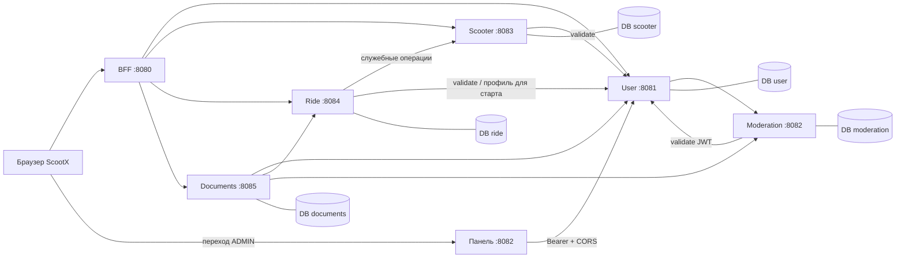

# Краткая записка для защиты

## Назначение и границы

Учебная аренда самокатов: регистрация/вход, каталог и nearest, поездки,
обновление позиции, расчёт, учебная оплата, PDF и администрирование блокировок.
Профиль доступен для чтения; избранное хранится локально по userId.
Координаты — дробные значения учебной евклидовой сетки. GPS/карта не обещаются.
Тариф — 50 ₽ за старт + 8 ₽ за каждую начатую минуту, минимум одна минута.
Реальные деньги не списываются, что явно отмечено в интерфейсе и PDF.

## Архитектура

Сервисы не читают чужие таблицы. Один локальный PostgreSQL содержит пять отдельных
баз; адреса можно вынести на разные PostgreSQL-серверы через DB_URL.
Один Docker-образ — оптимизация сборки: приложения всё равно запускаются отдельными
контейнерами/процессами; можно собрать каждый WAR и развернуть на отдельном Tomcat.

## Безопасность

JWT RS256 выдаёт только User. Приватный ключ доступен только его контейнеру.
Documents локально проверяет подпись/issuer/exp; все защищённые API проверяют
актуальность/отзыв через User validate. Validate не вызывает Moderation, поэтому
цикла запросов авторизации нет. После logout БД токенов запрещает старый JWT.

BFF хранит JWT в HttpOnly-сессии, не в localStorage. ADMIN получает токен во fragment
URL панели; панель убирает fragment и хранит токен в sessionStorage. Клиентский
редирект не даёт прав: User/Moderation проверяют ADMIN на сервере. Регистрация
создаёт только USER. Origin/Content-Type и строгий JSON проверяются на BFF.
Идентификаторы владельцев берутся из проверенного JWT, а не доверяются телу клиента.

Внутренние reserve/release/position Scooter защищены отдельным SERVICE_API_KEY,
который не выдаётся браузеру. Это позволяет восстановить поездку после истечения
или отзыва пользовательского JWT. Старый rideId не управляет новой резервацией.
Служебный ключ и RSA-ключи сохраняются в Docker volumes, в Git не попадают.

## Согласованность поездок

В Ride частичные уникальные индексы исключают две незавершённые поездки одного
пользователя/самоката. В Scooter изменение READY→IN_RIDE условное и транзакционное.
Операция хранится по rideId; отменённый ID не оживляется запоздалым reserve.

STARTING/CANCELLING/FINISHING — внутренние долговечные этапы. При finish сначала
фиксируются время/координаты/сумма, затем освобождается Scooter. При сбое повтор
и фоновое восстановление используют сохранённые данные, не увеличивают стоимость
за время аварии и не освобождают чужой самокат. Это компенсация и повторяемые
операции между двумя БД, а не общая распределённая SQL-транзакция.

Цена вычисляется BigDecimal по снимку тарифа. Pay отдельный, условный и
идемпотентный: конкурентные повторы получают один сохранённый paidAt.
Обновление позиции разрешено только владельцу ACTIVE, не меняет тариф/время;
финальная позиция определяется finish. Бан запрещает новый старт, но не finish/pay.

## Документы

Thymeleaf подставляет данные в три фиксированных шаблона, OpenHTMLtoPDF создаёт
PDF с встроенным кириллическим шрифтом. Текст пользователя экранируется, шаблоны
не принимаются от клиента. PDF-ресурсы и изображения не берутся из пользовательских URL.

Перед чеком проверяются владелец, PAID, сумма/валюта/даты реального Ride.
Для уведомления проверяется текущий бан. Метаданные имеют PENDING/GENERATED/FAILED.
PDF-файлы не хранятся, вместо них сохраняется JSON-снимок использованных данных.
Повторный download валидирует владельца и JWT, рендерит снимок без новой записи;
так историческое уведомление доступно после unban, история не меняется задним числом.

Метаданные доступны только своему пользователю, выдаются постранично. Delete —
soft delete: API скрывает запись, БД сохраняет её. Сбой генерации не выдаётся за
успешный PDF, старый PENDING переходит в FAILED и доступна повторная генерация.

## Воспроизводимость

Java 17, Jakarta Servlet 6.0, Tomcat 10.1, PostgreSQL 16, Maven, обычный JS.
Compose согласует порты/ROOT-контексты/зависимости, создаёт схемы и ключи.
Версионные миграции выполняются в транзакции с advisory lock и контролем SHA-256;
повторный запуск безопасен. Скрипты сохраняются с LF для Windows checkout.

Подтверждение готовности — тестовые отчёты, браузерные скачивания реальных PDF и
сценарии остановки/перезапуска сервисов. Пошаговая проверка: SUBMISSION_CHECKLIST.md.
